# ClaimCrew

**Azure 全託管醫療保險理賠多代理審核系統** — 文件抽取 → 條款比對(帶引用)→ 初審判定 → 人工覆核路由。全合成資料、零 PHI、零自建基礎設施。

> 🎬 Demo 影片(約 4.5 分鐘,中英字幕):https://youtu.be/emzxXhkF_Tk
>
> 完整規格見 [`ClaimCrew_PROJECT_SPEC.md`](ClaimCrew_PROJECT_SPEC.md)。本頁追蹤開發進度與 Azure 接入路線。

## 文件導覽

| 文件 | 內容 |
|---|---|
| [專案頁(中 / 英)](https://seancpc.github.io/ClaimCrew/) | 給讀者的總覽:架構、技術堆疊、亮點、成本、開發歷程 |
| [`ClaimCrew_PROJECT_SPEC.md`](ClaimCrew_PROJECT_SPEC.md) | 規格真相源:做什麼、為什麼、做到哪 |
| [`docs/adr/`](docs/adr/README.md) | 10 份架構決策紀錄(英文),含否決的替代方案 |
| [`docs/evidence/`](docs/evidence/EVIDENCE-20261001-single-agent.md) | 全部實驗與回歸的證據(49 部分),每個數字的出處 |
| [`docs/build-log.md`](docs/build-log.md) | 逐日開發紀錄與收尾統計 |
| [`docs/devlog.md`](docs/devlog.md) | 開發歷程:失敗的嘗試、pivot 與取捨 |
| [`docs/runbook.md`](docs/runbook.md) | 桌機操作、部署 / 拆除 / 重建步驟、長期停放漂移清單、備份還原 |
| [`app/agents/prompts/`](app/agents/prompts/) | 抽取與判定的 prompt |
| [`data/policies/`](data/policies/) | 三份虛構保單條款(住院定額 / 手術定額 / 實支實付) |

## 成本優先的開發流程(Cost-First Development)

本專案把「成本控制」當成一級工程目標,兩個核心手法:

1. **壓縮計費窗口(compress the metered window)**:所有不需雲的工作——合成資料、schema、Gate、eval、prompt、Bicep——在建立任何 Azure 資源**之前**全部完成;Azure 計費時鐘最後才啟動,付費期只做「只有雲上能做的事」
2. **拆建即成本控制(teardown as cost control)**:專案完成後以 Bicep 全拆(常駐費 $0),需要 demo 時依重建 Runbook 重建;repo 保存的是「可重生一切的原料與腳本」而非產物

預算硬上限 NT$5,000;實際成本記帳隨進度更新於下表。

## Azure 接入路線圖

```mermaid
flowchart LR
    subgraph P0["Phase 0 — 零成本前置 💰$0"]
        direction TB
        A1["合成資料全量<br/>(三保單 + 合成案 + 凍結真值)"]
        A2["統一 claim schema<br/>(Pydantic 單一真相源)"]
        A3["程式側 Gate + eval"]
        A4["prompt 草稿"]
        A5["Bicep 全套模板"]
        A6["CI + 文件骨架"]
    end

    subgraph P1["Phase 1 — 端到端骨架 💰計費開始"]
        direction TB
        B1["Bicep 首次部署"]
        B2["Document Intelligence<br/>(receipt prebuilt + custom neural)"]
        B3["AI Search Free<br/>(條款索引)"]
        B4["Azure OpenAI<br/>(單 agent 端到端)"]
        B5["Blob runs/ 全案落盤<br/>(Cosmos 已移除,ADR-010)"]
    end

    subgraph P2["Phase 2 — 按驗證邊界拆分與防護"]
        direction TB
        C1["抽取 gpt-4.1-mini / 判定 gpt-4o<br/>+ 程式側 Gate(47 種檢核)"]
        C2["模型分層路由<br/>(每案 −33.8%,ADR-007)"]
        C3["Foundry Agent Service<br/>(顧問模式 Repair,無放行權,ADR-008)"]
        C4["Content Safety 實測後不接主管線<br/>(ADR-009)"]
        C5["事件觸發 Container Apps Job<br/>+ Logic Apps 覆核閉環 + 失敗告警"]
    end

    subgraph P3["Phase 3 — 包裝與拆除 💰回到$0"]
        direction TB
        D1["ADR ×10 / 專案頁 / Demo 影片"]
        D2["重建 Runbook + 漂移清單"]
        D3["Bicep 全拆驗證<br/>(27 分 → 15 分)"]
    end

    P0 --> P1 --> P2 --> P3
```

## 開發進度

> 各階段條目為當時完成的紀錄;數字以本頁最下方「現況」與 v17 結果為準。

### Phase 0 — 零成本前置(已完成,2026-09-01;Azure 支出 $0)
- [x] 合成資料全量:三保單全文+PDF、合成理賠案三件套 JSON+PDF+真值(當時 72 案,現 73 案)、DI 訓練標註 71 份
- [x] 統一 claim schema 定案(Pydantic 單一真相源,`app/schemas/claim.py`)
- [x] 程式側 Gate(引用反查 / 金額複核 / 信心分流)+ eval(評 Gate 後判定,`--selfcheck` 滿分)
- [x] prompt 全套草稿(`app/agents/prompts/`,占位符範例 + 有據不假規則)
- [x] Bicep 模板(`infra/bicep/`,`bicep build` 0 errors;模型版本釘選)
- [x] CI(GitHub Actions)+ build log + 英文 ADR + GitHub Pages 專案頁骨架

### Phase 1 — 端到端骨架(已完成,2026-10-02)
- [x] Bicep 首次部署(資源群組、Blob、DI、Search、OpenAI;2026-09-30)
- [x] DI 接入:receipt prebuilt + 診斷書 custom neural `diagnosis-cert-v3`(真實觸發 8/8)
- [x] 條款入 Search(Free tier)
- [x] 單 agent 版端到端跑通與首次真實 eval

### Phase 2 — 按驗證邊界拆分與防護(已完成,2026-10-11)
- [x] 原規劃的「四 agent」改為按驗證邊界拆分(ADR-008):抽取 / 判定兩個 LLM 角色 + 程式側 Gate(47 種確定性檢核);Foundry Agent Service 只承載無放行權、預設關閉的顧問模式 Repair
- [x] 模型分層路由(ADR-007:抽取 gpt-4.1-mini、判定 gpt-4o,每案 −33.8%)+ token 成本記帳
- [x] Content Safety(groundedness / Prompt Shields)實測後劃定邊界、不接主管線(ADR-009)
- [x] 上雲:Event Grid → Storage Queue → Container Apps Job 事件觸發、Entra 受控身分無金鑰、Job 失敗告警
- [x] 人工覆核閉環:Logic Apps 摘要信 → 覆核表單 → `reviews-inbox/` → `tools/review_stats.py`
- [x] 程式填引文、掃描化 / 雜訊 PDF 變體測試、多輪全量回歸(v2–v17)

### Phase 3 — 文件定稿與拆除(已完成,2026-10-19)
- [x] ADR-001~010 全英文
- [x] 重建 Runbook(`docs/runbook.md`)+ 長期停放漂移清單(§7,D1~D17)
- [x] Bicep 全拆驗證兩次:2026-10-08 拆除 27 分後重建、2026-10-16 拆除 15 分;拆除隔日帳單 NT$0
- [x] Demo 影片、GitHub Pages 中英專案頁、build log 收尾統計

## 現況(v17 全量回歸,2026-10-11)

| 指標 | 結果 |
|---|---|
| 放行錯(核付金額錯 / 不該拒卻自動拒付) | 0 / 0(自動核付 24 件金額全對、自動拒付 20 件全對) |
| 危險錯 | 0 |
| Gate 後正確率 / 需人工召回 | 0.726 / 1.0 |
| 測試 / 變異 | 1,362 tests;手寫變異 225 + 5 + 6 全殺 |

詳見 `docs/evidence/EVIDENCE-20261001-single-agent.md` 第四十八部分。

## 成本記帳

| 期間 | 階段 | Azure 實際支出 | 備註 |
|---|---|---|---|
| 2026-08-30 ~ 09-01 | Phase 0 | $0 | 尚未建立任何 Azure 資源 |
| 2026-10 | Phase 1–3 | NT$2,189.19 | 約 97% 為模型呼叫;一輪 73 案全量約 NT$67;2026-10-16 全拆後每日 NT$0 |

## Build Log

逐日開發紀錄見 `docs/build-log.md`;品質基準一鍵重跑:`bash tools/gauntlet.sh`(測試/型別/lint/供應鏈審計/變異五層)。
