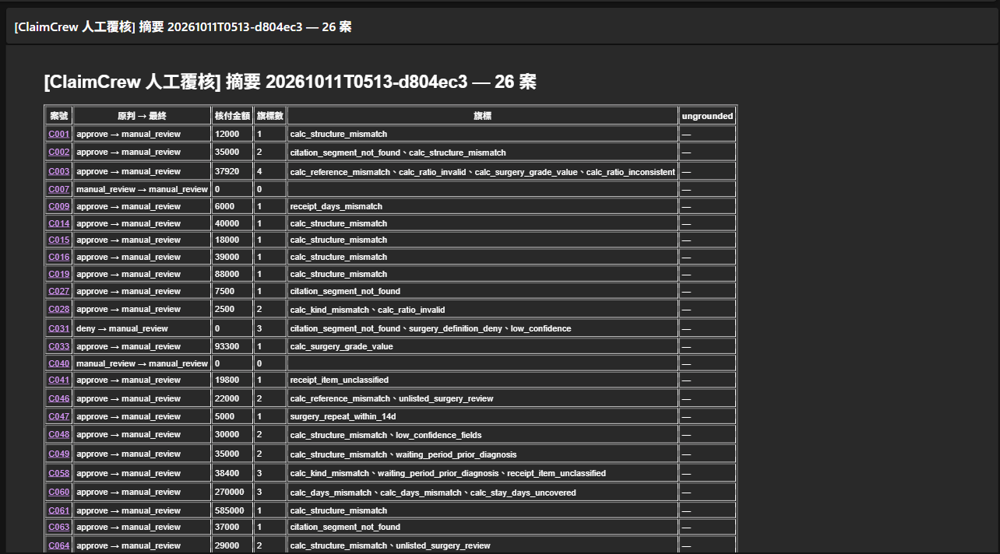

# ClaimCrew

**Medical Insurance Claims Review on Fully Managed Azure** — Azure 全託管醫療保險理賠審核系統

[English](#english) | [繁體中文](#zh-tw)

[](https://github.com/seancpc/ClaimCrew/actions/workflows/ci.yml) [](LICENSE)

[Project page](https://seancpc.github.io/ClaimCrew/) · [Demo video](https://youtu.be/emzxXhkF_Tk) · [ADRs](docs/adr/README.md) · [Evidence](docs/evidence/EVIDENCE-20261001-single-agent.md) · [Build log](docs/build-log.md) · [Devlog](docs/devlog.md) · [Runbook](docs/runbook.md) · [Spec](ClaimCrew_PROJECT_SPEC.md)

Python · Azure OpenAI (gpt-4o / gpt-4.1-mini) · Document Intelligence · AI Search · Foundry Agent Service · Container Apps Jobs · Event Grid · Logic Apps · Bicep · Pydantic v2 · pytest · hypothesis

---

<a id="english"></a>

## English

A claims-review pipeline where **the LLM reads the documents and code decides what gets paid**. Document Intelligence and gpt-4.1-mini extract the claim, gpt-4o matches policy clauses with citations, and a program-side Gate of 47 deterministic checks either releases the decision or routes it to a human. Built entirely on fully managed Azure services, with every case synthetic (zero PHI). Cost was treated as an engineering goal: everything that did not need the cloud was finished at $0 first, and the whole environment is torn down with Bicep when not in use.



### TL;DR

- **The model has no release authority.** Payout amounts are summed from the model's calculation lines and cross-checked by code; any failed check sends the case to a human.
- **Full regression (v17, 73 cases, event-triggered in the cloud):** all 24 auto-approved payouts exact, all 20 auto-denials correct, 0 dangerous errors, manual-review recall 1.0.
- **Cost:** NT$2,189 (≈ US$68) total cloud spend in October 2026 development, about NT$67 per 73-case run, NT$0 per day after a 15-minute teardown.
- **Failures are part of the record:** two "LLM repairs, then releases" designs, a standalone Policy agent and Azure groundedness detection were all measured and rejected. Each decision is written up as one of 10 ADRs.

### 1. The Problem: an LLM that is usually right is still not allowed to pay

A claims adjudicator has an asymmetric cost: a wrong payout is money lost, a wrong denial harms a policyholder, while a case sent to a human only costs time. An LLM that reads documents well still makes arithmetic slips, picks a legal value that is not this case's value, or quotes a clause slightly wrong — and it does so differently on each run.

ClaimCrew does not try to make the model right every time. It draws a boundary: the model fills in facts and calculation material, and only code may release a decision.

### 2. Core Method

```
  Request file upload (Blob) → Event Grid → Storage Queue
                         │
                         ▼
        Container Apps Job (Entra managed identity, keyless)
                         │
                         ▼
  Document Intelligence (prebuilt receipt / custom neural certificate; Blob cache)
                         │
                         ▼
  Extraction  gpt-4.1-mini: unified schema with per-field confidence
                         │
                         ▼
  Intake      code: missing documents → human review
                         │
                         ▼
  Decision    gpt-4o: AI Search clause retrieval → decision + calculation lines + clause segments
                         │
                         ▼
              code: fill verbatim quotes, sum the payout
                         │
                         ▼
  Gate        code: 47 deterministic checks
                         │
        ┌────────────────┼────────────────┐
        ▼                ▼                ▼
   auto-approve      auto-deny       human review
                                          │
                                          ▼
       Logic Apps digest email → review form → reviews-inbox → stats
```

- **Split at verification boundaries, not knowledge domains:** a role exists only where a deterministic check separates it from its neighbour (ADR-008).
- **LLM fills material, code computes:** day counts, intervals and days since the policy start are computed by code and injected; the payout is the program's sum of the model's lines.
- **Reverse checks ask two questions:** is the value legal, and is it *this case's* value (the right surgery grade, the right stay segment, the right cap group).
- **One quality gate:** `bash tools/gauntlet.sh` runs tests in random order with coverage → mypy strict → ruff → pip-audit → hand-written mutation testing (with a property-only subset) → eval self-check.

### 3. How it compares to a typical LLM claims demo

| | Typical demo | This project |
|---|---|---|
| Who releases a payout | the model's answer | code, after 47 checks; the model cannot release |
| Citations | model-written quotes | the model points to a clause segment, code fills the exact text |
| "Accuracy" | one number | release errors counted in both directions (wrong payout *and* wrongful auto-deny), judged against a range of past runs |
| Multi-agent | as many agents as possible | only where a verification boundary justifies one; one advisory agent, off by default |
| Cost | not reported | metered actuals, per-run cost, $0 standing cost |

**Why not let an LLM repair flagged cases?** It was tried twice with six deterministic guards. Post-Gate accuracy rose (0.694 → 0.792), but each round released one wrong amount, and every one of those mapped to a hole in the Gate. The repair agent was kept as advisory only and the holes were closed with deterministic checks (ADR-008).

**Why gpt-4o 2024-11-20 and gpt-4.1-mini?** The originally pinned versions were already deprecating in the region and the subscription had no GlobalStandard quota, so the deployable Standard versions were pinned instead. Moving extraction to gpt-4.1-mini cut per-case cost by 33.8% with no regression on the 72-case eval at the time (ADR-007). Any model change is treated as a regression re-run.

**Why AI Search Free and no Cosmos DB?** The clause index is small, so the Free tier with direct API calls avoids a Basic tier's fixed monthly fee (ADR-005). Cosmos DB was deployed and then removed when no code read it; every run is persisted to Blob instead (ADR-010).

### 4. Engineering trail

- ❌ **A standalone Policy agent lost context:** clause recall 0.772 on 10 cases; it missed clauses whose applicability follows from the claim facts. Policy and adjudication stay in one call.
- ❌ **LLM repair with release authority lost money** even behind six guards (C003 −2,000: the model shrank a receipt to satisfy a cap; C055 +5,000: a per-segment cap the Gate did not check).
- ❌ **Azure groundedness detection had no discriminating power here:** a fabricated pre-existing-condition claim was caught 0/3, a legitimate sourced deny was flagged 3/3, and clean day-count claims raised 12/12 false alarms. Not wired in (ADR-009).
- 🔧 **The metric hid a direction:** counting release errors only on payouts missed 6 wrongful auto-denials across 18 historical runs. Release errors are now counted both ways.
- 🔧 **A fix that removes a flag can expose a hole:** code-filled citations passed a 1,300-case replay unchanged, but the first live subset released C069 with +1,300. The image was rolled back, the cap grouping fixed, and the subset re-run clean before the full run.

### 5. Results

Scale: 3 fictional policies (100 clauses), 73 synthetic claims (41 approve / 23 deny / 9 manual), ground truth hand-checked case by case and frozen.

| Metric (v17 full regression) | Result |
|---|---|
| Release errors (wrong payout / wrongful auto-deny) | **0 / 0** — 24 auto-approved payouts exact, 20 auto-denials correct |
| Dangerous errors (should deny, paid instead) | 0 |
| Post-Gate accuracy / manual-review recall | 0.726 / 1.0 |
| Misquoted citations / clause segment not found | 0 / 1.5% |
| Routed to humans | 29 (the price of "when in doubt, ask a human") |

| Cost (Azure Cost Management actuals) | Amount |
|---|---|
| October 2026 development, total | NT$2,189 (~97% model usage; budget 3,000) |
| One 73-case full run | ≈ NT$67 |
| Idle environment | ≈ NT$4–5 / day |
| After teardown | NT$0 / day; teardown 27 → 15 minutes |

- **Robustness:** 13 cases rendered as light / heavy scanned-noise PDFs (78 pages): 0 release errors, DI misreads caught by low-confidence flags. 9 prompt-injection variants (approve and deny cases): 0 released, 0 decision flips.
- **Quality engineering:** 1,362 tests, 225 + 5 + 6 hand-written mutants all killed, CI green.
- **Effort:** about 100 hours of hands-on, AI-assisted work (estimated from commit history; a lower bound), 37 SPECs, 10 ADRs.

### 6. Transferability

The pattern fits any process that simultaneously has (1) documents to read, (2) written rules with amounts or limits, and (3) a cost asymmetry between a wrong automatic decision and a human review.

→ Expense reimbursement, warranty claims and loan-document checks all qualify. Swap the policies, schema and Gate checks; the extract → decide → Gate → human structure, the eval and the teardown discipline stay the same.

### 7. Tech Stack

- **AI models:** Azure OpenAI gpt-4o 2024-11-20 (decision), gpt-4.1-mini 2025-04-14 (extraction), Structured Outputs (JSON Schema)
- **Document understanding:** Azure AI Document Intelligence (prebuilt receipt; self-trained custom neural model for medical certificates)
- **Retrieval:** Azure AI Search (Free tier, clause index)
- **Agent:** Azure AI Foundry Agent Service (advisory Repair agent, no release authority, off by default)
- **Orchestration:** Azure Container Apps Jobs, Event Grid, Storage Queue (KEDA), Blob Storage
- **Human review:** Azure Logic Apps (digest email + review form)
- **Ops & security:** Azure Monitor / Log Analytics alerts, Cost Management budgets, Entra managed identity + RBAC (keyless), Bicep IaC, Azure Container Registry, GitHub Actions
- **Code & quality:** Python 3.11, Pydantic v2 (single source of truth for schemas), pytest + hypothesis, mypy strict, ruff, pip-audit, hand-written mutation testing
- **Evaluated, not adopted:** Azure AI Content Safety groundedness detection and Prompt Shields (ADR-009)

### 8. Limitations

- All data is synthetic: three fictional teaching-grade policies and 73 generated claims. Ground truth was written by the author and reviewed case by case; there is no real-world test set.
- Post-Gate accuracy is 0.726: the Gate prefers human review, so 29 of 73 cases go to a person. Run-to-run variance is about ±3–4 cases, so changes are judged against a multi-run range.
- Documents are clean generated PDFs plus synthetic scan noise; handwriting and real-world layouts are not covered.
- Foundry Agent Service hosts only the advisory agent; the production path does not depend on it.
- The review loop is single-reviewer and append-only. There is no supplementary-document workflow (out of scope).
- The environment is torn down. Reproducing cloud runs means rebuilding from `infra/bicep/` with `docs/runbook.md` (Azure subscription and model quota required).

### 9. Reproduce

| File | Who installs it | Contents |
|---|---|---|
| `requirements.txt` | every environment | pinned runtime dependencies (Azure SDKs, Pydantic, PDF tooling) |
| `requirements-dev.txt` | to run tests / `tools/gauntlet.sh` | pytest, hypothesis, mypy, ruff, pip-audit |

```bash
python3.11 -m venv .venv && source .venv/bin/activate
pip install -r requirements.txt -r requirements-dev.txt
bash tools/gauntlet.sh                      # full quality gate (offline, no Azure needed; about 40–50 minutes)
python3 -m eval.run_eval --selfcheck        # eval pipeline self-check (truth as prediction must score 100%)
python3 -m app.datagen.cases --force        # regenerate the synthetic claims (claim.json / truth.json)
python3 -m app.datagen.render_pdf           # re-render the claim and policy PDFs (needs a CJK TTF font)
```

Running the pipeline against Azure requires deploying `infra/bicep/main.bicep`; the step-by-step rebuild and the long-term drift checklist are in `docs/runbook.md`.

### 10. Data & Compliance

- This project is a technical demonstration, not an insurance product. The policy clauses are fictional teaching texts and constitute no offer or basis for any claim.
- All claims, names, hospitals and medical content are synthetic; there is no real patient data, personal data or PHI anywhere in the repo. Every generated PDF is labelled as synthetic, and review cards mask names in free-text fields.
- Code is MIT-licensed (see `LICENSE`). No employer resources or internal document formats were used.

---

<a id="zh-tw"></a>

## 繁體中文

一條**模型負責讀文件、程式決定放不放款**的理賠審核管線:Document Intelligence 與 gpt-4.1-mini 抽取文件,gpt-4o 比對條款並附引用,再由程式側 Gate 的 47 種確定性檢核決定放行或轉人工。全部建在 Azure 全託管服務上,所有案件皆為合成資料(零 PHI)。成本也是一級工程目標:不需上雲的工作先以 $0 完成,環境不用時以 Bicep 全拆。


### TL;DR

- **模型沒有放行權**:核付金額由程式從模型的算式明細加總並反查條款;任一檢核未過即轉人工。
- **全量回歸(v17,73 案,雲端事件觸發)**:自動核付 24 件金額全對、自動拒付 20 件全對、危險錯 0、需人工案件召回 1.0。
- **成本**:2026 年 10 月開發期雲端總花費 NT$2,189,一輪 73 案全量約 NT$67,15 分鐘拆除後每日 NT$0。
- **失敗也入冊**:兩種「LLM 修補後放行」設計、獨立 Policy agent、Azure groundedness 偵測都經實測後否決,每個決策寫成 10 份 ADR 之一。

### 1. 問題:通常答對的 LLM,仍然不該有付款權

理賠審核的代價不對稱:付錯是賠錢,拒錯傷害保戶,送人工只是多花時間。擅長讀文件的 LLM 仍會算錯、填了合法但不是本案的值、引文差一點點——而且每次錯法都不一樣。

ClaimCrew 不追求讓模型每次都對,而是劃一條邊界:模型填事實與算式材料,只有程式能放行。

### 2. 核心方法

```
  上傳請求檔(Blob)→ Event Grid → Storage Queue
                         │
                         ▼
        Container Apps Job(Entra 受控身分,無金鑰)
                         │
                         ▼
  Document Intelligence 抽取(收據 prebuilt / 診斷書 custom neural;Blob 快取)
                         │
                         ▼
  Extraction  gpt-4.1-mini:整理成統一 schema(帶欄位信心)
                         │
                         ▼
  Intake      程式:缺件即轉人工
                         │
                         ▼
  Decision    gpt-4o:AI Search 檢索條款 → 判定 + 算式明細 + 條款段落
                         │
                         ▼
              程式:填入引文原文、加總核付金額
                         │
                         ▼
  Gate        程式:47 種確定性檢核
                         │
        ┌────────────────┼────────────────┐
        ▼                ▼                ▼
    自動核付          自動拒付          人工覆核
                                          │
                                          ▼
        Logic Apps 摘要信 → 覆核表單 → reviews-inbox → 統計
```

- **按驗證邊界拆角色,不按知識領域拆**:只有在兩個角色之間有確定性檢核隔開時,才拆成兩個角色(ADR-008)。
- **LLM 填材料、程式算數**:住院日數、間隔、距生效日由程式算好注入;核付金額是程式對模型明細的加總。
- **反查問兩個問題**:這個值合法嗎?它是**本案**該用的值嗎(手術等級、住院分段、限額群組)?
- **單一品質閘門**:`bash tools/gauntlet.sh` 依序跑隨機順序測試 + 覆蓋率 → mypy strict → ruff → pip-audit → 手寫變異測試(含 property 子集)→ eval 自檢。

### 3. 跟一般 LLM 理賠 demo 比,好在哪

| | 一般 demo | 本專案 |
|---|---|---|
| 誰放款 | 模型的答案 | 程式,通過 47 種檢核後;模型無放行權 |
| 引文 | 模型自己寫 | 模型只指條款段落,程式填入原文 |
| 「準確率」 | 一個數字 | 放行錯雙向計數(付錯金額**和**錯誤自動拒付),以多輪歷史區間判斷是否退步 |
| 多代理 | 越多越好 | 只在驗證邊界成立時拆;唯一的顧問 agent 預設關閉 |
| 成本 | 不提 | 實帳、每輪成本、常駐費 $0 |

**為什麼不讓 LLM 修補被攔下的案件?** 試過兩輪,外加六道確定性防護。Gate 後正確率確實上升(0.694 → 0.792),但每輪都放行一件金額錯,而每一件都對應一個 Gate 漏洞。修補 agent 改為顧問模式,漏洞改用確定性檢核補上(ADR-008)。

**為什麼是 gpt-4o 2024-11-20 與 gpt-4.1-mini?** 原本釘選的版本在該區域已進入淘汰期,訂閱也沒有 GlobalStandard 配額,所以改釘可部署的 Standard 版本。抽取改用 gpt-4.1-mini 後每案成本降 33.8%,72 案 eval（當時版本）不退步(ADR-007)。任何模型變更都視為需要重跑回歸。

**為什麼用 AI Search Free、不用 Cosmos DB?** 條款索引很小,Free tier 加直呼 API 就夠,省下 Basic tier 的固定月費(ADR-005)。Cosmos DB 部署後發現程式零引用,於是移除,全案改由 Blob 落盤(ADR-010)。

### 4. 工程歷程

- ❌ **獨立 Policy agent 丟失脈絡**:10 案條款召回 0.772,漏掉需要依案件事實才知道適用的條款;條款比對與判定維持同一次呼叫。
- ❌ **有放行權的 LLM 修補層會賠錢**,即使有六道防護(C003 −2,000:模型縮小收據金額來湊限額;C055 +5,000:Gate 沒有的分段限額)。
- ❌ **Azure groundedness 在這個任務沒有鑑別力**:捏造的既往症主張 0/3 被抓到,有源頭的合法拒付 3/3 被判捏造,乾淨案的日數主張 12/12 誤報;不接主管線(ADR-009)。
- 🔧 **指標藏了一個方向**:只計核付方向的放行錯,漏掉 18 輪歷史中 6 件錯誤自動拒付;現在雙向計數。
- 🔧 **消除旗標的修正會露出漏洞**:程式填引文在 1,300 案次重放下零變動,但第一次線上子集就放行 C069 +1,300;回退映像、補上限額群組、子集重跑通過後才跑全量。

### 5. 結果

規模:3 份虛構保單(100 條)、73 件合成理賠案(核付 41 / 拒付 23 / 人工 9),真值人工逐案檢核後凍結。

| 指標(v17 全量回歸) | 結果 |
|---|---|
| 放行錯(核付金額錯 / 不該拒卻自動拒付) | **0 / 0** —— 自動核付 24 件金額全對、自動拒付 20 件全對 |
| 危險錯(該拒付卻核付) | 0 |
| Gate 後正確率 / 需人工召回 | 0.726 / 1.0 |
| 引文抄錯 / 條款段落找不到 | 0 / 1.5% |
| 轉人工 | 29 件(寧可人工的代價) |

| 成本(Azure Cost Management 實帳) | 金額 |
|---|---|
| 2026 年 10 月開發期總花費 | NT$2,189(約 97% 為模型費用;預算 3,000) |
| 一輪 73 案全量 | 約 NT$67 |
| 環境閒置 | 約 NT$4–5 / 日 |
| 拆除後 | NT$0 / 日;拆除耗時 27 → 15 分鐘 |

- **韌性**:13 案渲染成輕度 / 重度掃描雜訊 PDF(78 頁):放行錯 0,DI 誤讀皆被低信心旗標接住。9 個提示注入變體(核付與拒付案):放行 0、判定翻轉 0。
- **品質工程**:1,362 個測試,225 + 5 + 6 個手寫變異全殺,CI 全綠。
- **投入**:約 100 小時 AI 協作開發(依 commit 時戳估算,為下限)、37 份 SPEC、10 份 ADR。

### 6. 可遷移性

本模式適用於同時具備三條件的流程:(1) 有文件要讀、(2) 有含金額或限額的明文規則、(3) 錯誤自動決策與送人工之間代價不對稱。

→ 費用報銷、保固理賠、貸款文件審查皆命中。換掉保單、schema 與 Gate 檢核,「抽取 → 判定 → Gate → 人工」的結構、eval 與拆建紀律都不用動。

### 7. 技術棧

- **AI 模型**:Azure OpenAI gpt-4o 2024-11-20(判定)、gpt-4.1-mini 2025-04-14(抽取)、Structured Outputs(JSON Schema)
- **文件理解**:Azure AI Document Intelligence(收據 prebuilt;診斷書自訓 custom neural)
- **檢索**:Azure AI Search(Free tier,條款索引)
- **Agent**:Azure AI Foundry Agent Service(顧問模式 Repair agent,無放行權,預設關閉)
- **編排**:Azure Container Apps Jobs、Event Grid、Storage Queue(KEDA)、Blob Storage
- **人工覆核**:Azure Logic Apps(摘要信 + 覆核表單)
- **維運與安全**:Azure Monitor / Log Analytics 告警、Cost Management 預算、Entra 受控身分 + RBAC(無金鑰)、Bicep IaC、Azure Container Registry、GitHub Actions
- **程式與品質**:Python 3.11、Pydantic v2(schema 單一真相源)、pytest + hypothesis、mypy strict、ruff、pip-audit、手寫變異測試
- **已評估未採用**:Azure AI Content Safety 的 groundedness 偵測與 Prompt Shields(ADR-009)

### 8. 限制

- 全部是合成資料:3 份教學級虛構保單、73 件生成案件;真值由作者撰寫並逐案檢核,沒有真實世界測試集。
- Gate 後正確率 0.726:Gate 寧可人工,73 案中 29 件送人;單輪波動約 ±3~4 案,所以改動以多輪區間判斷。
- 文件是乾淨的生成 PDF 加上合成掃描雜訊,不涵蓋手寫與真實版面。
- Foundry Agent Service 只承載顧問 agent,主路徑不依賴它。
- 覆核閉環為單人、只增不改;沒有補件流程(刻意不在範圍內)。
- 環境已拆除。重現雲端執行需依 `infra/bicep/` 與 `docs/runbook.md` 重建(需 Azure 訂閱與模型配額)。

### 9. 重現

| 檔案 | 誰要裝 | 內容 |
|---|---|---|
| `requirements.txt` | 所有環境 | 釘版的執行依賴(Azure SDK、Pydantic、PDF 工具) |
| `requirements-dev.txt` | 要跑測試 / `tools/gauntlet.sh` 時 | pytest、hypothesis、mypy、ruff、pip-audit |

```bash
python3.11 -m venv .venv && source .venv/bin/activate
pip install -r requirements.txt -r requirements-dev.txt
bash tools/gauntlet.sh                      # 全部品質閘門(離線、不需 Azure;約 40~50 分鐘)
python3 -m eval.run_eval --selfcheck        # eval 管線自檢(真值當預測必須滿分)
python3 -m app.datagen.cases --force        # 重新生成合成案件(claim.json / truth.json)
python3 -m app.datagen.render_pdf           # 重新渲染案件與保單 PDF(需 CJK TTF 字型)
```

對 Azure 實際執行管線需先部署 `infra/bicep/main.bicep`;逐步重建與長期停放漂移清單見 `docs/runbook.md`。

### 10. 資料與合規

- 本專案為技術展示用途,不是保險產品;保單條款為教學級虛構文本,不構成任何要約或理賠依據。
- 全部理賠案件、人名、醫院、病歷內容皆為合成資料,repo 內沒有任何真實病歷、個資或 PHI;每份生成 PDF 內文標註為合成資料,覆核卡片對自由文字欄做姓名遮罩。
- 程式碼採 MIT License(見 `LICENSE`);開發全程未使用任何公司資源與內部文件格式。
