# 開發歷程紀錄(Portfolio 素材)

## 2026-08-30 — 變異測試首輪即挖出測試盲點(M3)

- **起因**:claim schema(Pydantic 單一真相源)與 structured outputs 轉換層完成後,以證據優先流程回補完整 gauntlet 做「再確認」。當時 13 個測試全綠、coverage 100%、mypy/ruff 零警告——表面上無懈可擊。
- **嘗試過程**:手動植入 6 個 mutant 逐一驗證測試套件會不會咬人。M1~M2、M4~M5 全殺,但 M3(拿掉「遞迴進 array items」的強制邏輯)存活——套件全綠、coverage 仍 100%,卻沒有任何測試發現核心語意被砍掉一塊。
- **關鍵考量與抉擇**:分析存活原因:現有模型的陣列元素全是 `$ref`(由 `$defs` 迴圈另行接住),被砍的路徑守的是「未來的 inline 巢狀形狀」,對現有模型是死路徑。兩個選項:標記為等價 mutant 略過,或承認「測試只驗了模型輸出、從未直接驗函式語意」是真盲點。選了後者——補一個對 `_enforce_subset` 手構 inline array-of-object 的直接單元測試,M3 復殺,最終 6/6。
- **最終結果**:coverage 100% 與變異 6/6 的差距具體呈現了「覆蓋率是偵測器不是目標」——執行到的行不等於被斷言的行為。另收穫:變異腳本本身連錯三次(grep 未用 `-F`、殘留偵測預期次數設錯、sed 改壞入口腳本),印證「會改動原始碼的檢測腳本必須自帶殘留偵測」的必要性。

### 附:當日基準數字
13 tests passed / changed-line coverage 100%(75 stmts, 10 branches)/ mypy 0 errors / ruff 0 warnings / 手動變異 6/6 killed(`tools/mutation_schema.sh` 可重跑)

## 2026-09-01 — ❌ 失敗紀錄:40 案真值我自己驗全綠,人工檢核卻抓出 7 個錯

- **起因**:eval set(40 案合成理賠案 + 真值)完成,程式面全部通過——`--selfcheck` 對 40 案 accuracy 1.0、金額誤差全 0、不變量斷言全過、CI 全綠。但案件、條款、真值三者都是我產出的,自我一致不等於正確:若我對條款的理解有偏差,案件與真值會一起錯、且錯得完全一致,任何自動檢查都抓不到。於是出一份逐案檢核表交人工判定。
- **嘗試過程**:40 案總表(案情 / 提議判定 / 金額推導式 / 條款依據 + 空白核可欄)交付後,人工逐案核出 6 個 x。其中最嚴重的是 C007:推導式寫「依第26條通知補正」,但 POL-B 第 26 條是〈詐欺與不實告知之效果〉,補正是第 23 條——在理賠語境把文件矛盾件掛到詐欺條,後果嚴重。其餘:C026 無保單號碼卻引具體條號(三張保單條號各異)、C031 論證方向錯(內視鏡輔助切除本就是正面表列的手術,爭點應在等級而非是否為手術)、C033~C035 申請金額欄誤填成核付金額(案型標「超限截斷」卻申請=核付,自相矛盾)。
- **關鍵考量與抉擇**:修正 C035 時連帶發現第 7 個錯——原診斷「脊椎滑脫」的對應術式根本不在 POL-C 附錄一,會變成「未列表→需人工」與核付判定矛盾;改為附錄一明列的「退化性髖關節炎 + 全髖關節置換術」,金額不變。這類錯誤的共通點是**跨檔案的語意一致性**(條號 ↔ 條文內容、案型標籤 ↔ 欄位數值、術式 ↔ 等級表),程式只能驗結構與算術,驗不了「這個條號指向的條文是不是這個意思」。
- **最終結果**:6 個 x 全數修正 + 8 項建議落實(手術名稱入推導式以便回查等級、病房費限額表述統一為 `min()`、去除兩案重複),重新生成 40 案並逐案斷言驗證通過,eval set 凍結、SPEC §14 記錄「此後改動需記錄理由」。教訓寫成一句:**AI 出的題不能由 AI 自己閱卷**——這半小時的人工檢核,是整個 Phase 0 裡人類槓桿最高的半小時。

### 證據一:人工檢核意見(紅筆)

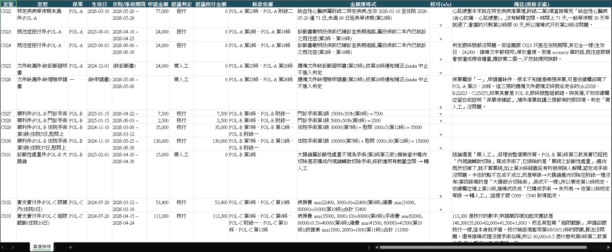

### 證據二:檢核意見 → 版本控制裡可追溯的修正(C007)

```diff
   "decision": "manual_review",
   "approved_amount": "0",
-  "derivation": "…依第26條(POL-B 第22條應備文件之診斷書須載明手術名稱)須釐清 → 轉人工",
+  "derivation": "胃鏡依第2條第三款屬診斷性處置不視為手術;惟收據列手術費 15,000 與診斷書治療摘要不符,
+                 第22條第二款要求診斷書載明手術名稱 → 依第23條通知補正並轉人工",
   "clause_basis": [
     "POL-B 第2條",
-    "POL-B 第22條"
+    "POL-B 第22條",
+    "POL-B 第23條"
   ]
```

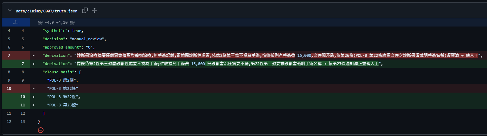

### 附:當日狀態
40 案(approve 23 / deny 10 / manual_review 7)· eval `--selfcheck` PASS · 27 tests / mypy 0 / ruff 0 · CI 全綠(見 `screenshots/20260901_CI全綠.png`)· Azure 成本 $0

## 2026-09-02 — 架構決策:一張診斷書、兩段住院,schema 該在哪一層變成列表

- **起因**:Phase 0 收尾做全專案稽核時發現 C008(出院 10 日後同病再入院,依條款視為同一次住院)在 schema 裡表達不出來——`DiagnosisCertificate` 只有一組入院日/出院日,第二段住院只能塞在治療摘要的自由文字裡,等於把最關鍵的合併判斷輸入藏給 LLM 自己去讀。這是稽核 15 項裡唯一的設計層缺陷,其他 14 項改完才動它。
- **嘗試過程 / 選項**:①列為已知限制不改(最省,但 eval 的合併住院案就形同作弊);②改為 `admissions` 列表——再分兩條路:(a) Document Intelligence 的訓練標註也做成重複群組,抽取層直接吐列表;(b) DI 維持平面欄位、只標第一段,列表由 Extraction Agent 從 PDF 文字整理。
- **關鍵考量與抉擇**:(a) 看起來最「乾淨」,但 custom neural 對重複群組欄位的標註格式在 Azure 開通前完全無法驗證,而 labels.json 本身已經是「依訓練知識撰寫、待 Phase 1 校正」的狀態,再疊一層未驗證格式是把風險放在最貴的地方。(b) 把不確定性留在 LLM 層——那裡本來就有 prompt 規則、信心分數與 Gate 在管;代價是 prompt 多一條「每段住院各自一元素、禁止合併」的鐵律。ICU 日數順勢一併進列表(每段各有 ICU 日數才算完整,不然 C018/C019 的加護日數又要回到自由文字)。選 (b)。
- **最終結果**:schema 加 `Admission`(入院日/出院日/ICU 日數),40 案 claim.json、PDF、DI 標註全部重生成,PDF 多段住院以「第N次」前綴、單段不加前綴以維持 DI 標籤相容;真值 40 份逐檔 diff 零變動(改的是表達方式不是答案);資料不變量新增「多段遞增不重疊」「ICU ≤ 該段日數」。遺留:DI 平面標註只涵蓋第一段,Phase 1 要用 C008 真實觸發驗證 Extraction Agent 是否確實拆出兩段。

## 2026-09-07 — 一個「重複案」的替換,變成三張保單的條款結構考點

- **起因**:第二輪稽核發現 C009(甲狀腺結節射頻消融)與 C040(肝腫瘤射頻消融)是同一種「未列表手術→人工」案,40 案裡等於少測一種情境;而 SPEC 刻意設計的六類陷阱中,「收據與診斷不符」只有 C007 一案,是最薄的一類。兩個選項:只補 C009 漏引的條號(十分鐘,零風險),或把 C009 整案改成第二個不符件(動凍結真值、要重過人工檢核)。使用者選後者。
- **嘗試過程**:我先設計 C009 為 POL-A 日數矛盾件(診斷書住院 2 日、收據病房費 5 日、申請金額 15,000 恰為 3,000×5),推導式寫「文件矛盾視為文件不全,依第 25、26 條補正轉人工」。人工檢核通過分類與條號,但指出三件事:①「視為文件不全」沒交代理由——POL-A 第 25 條四項文件形式上全齊,第 26 條文義是「文件不全」,內容矛盾嚴格說不是不全,要引就得明講是目的性擴張;②期間本身也矛盾(5 日的話出院日該是 5/19),申請書站在收據那邊讓證據結構變 2 比 1,考點從「有矛盾」升級成「不能多數決」;③補第 2 條住院定義與第 27 條給付期限未起算。
- **關鍵考量與抉擇**:我順手把 C007 也標成「同型問題」,建議比照補目的性擴張——被駁回。使用者指出兩案表面同型、條款結構不同:POL-B 第 22 條第二款括號寫明「應載明手術名稱及手術日期」,C007 的診斷書本身就不合規,第 23 條直接適用,不必擴張;C007 真正缺的是「收據手術費先構成表面證據 → 診斷書不符內容要求」這一步,架好後有無手術兩種可能都收進補正同一出口。再對照 POL-C 第 26 條〈收據項目分類爭議之處理〉根本是為這類情況專寫的。三張保單對同一種矛盾有三種不同的處理路徑(A 無內容要求須擴張 / B 有內容要求直接適用 / C 有專條),這個不對稱本身就是考點——agent 得知道在哪張保單有現成工具、在哪張得自己想辦法。
- **最終結果**:C009 改案(推導式含期間矛盾、目的性擴張理由、6 條依據),C007 推導式重寫成「表面證據→內容要求→兩種可能同一出口」,兩案判定與分布(23/10/7)不變。留一個坑:POL-C 第 26 條專條版目前沒有案子,若 Phase 1 實測發現「文件矛盾」是弱點,C009 骨架可直接改成 POL-C 版補上第三條路。教訓:**我看到的是「兩案長得像,說詞該統一」,人工檢核看到的是「兩案條款不同,說詞必須不同」——條款結構的差異只有真的逐條讀過才看得出來,這正是真值屬人類保留區的原因。**

## 2026-09-08 — 從 41 案補到 72 案:用「提案總表 → 人工逐案勾」把真值當人類保留區來擴量

- **起因**:Phase 0 收尾時 eval set 只有 41 案,POL-C 一個 deny 都沒有、除外責任只有 3 案、陷阱類多數只剩 1~3 案;統計上一案就是 2.4% accuracy,Phase 2 要比兩個模型時差一案就翻盤。要補案,但真值屬人類保留區,不能由我一個人出題又閱卷。
- **嘗試過程**:改成固定流程——我出「提案總表」(案情 / 提議判定 / 金額 / 推導式 / 條款依據 / 考點,分布由資料 groupby 自動算),使用者逐案勾 v/x 並寫意見,勾完才寫進生成器、整批 `--force` 重生成、用 git diff 證明既有案位元組零變動。五批 33 案(C042–C072)全部走這條線,x 掉 3 案(C047 與 C038 同型、C073 條款解釋未定、C074 非單變數),另有十幾處由檢核意見修正(申請額改毛額、術式對齊附錄一、戳記改成條款要件文字、機構名稱改掉台灣不存在的執照型態……)。
- **關鍵考量與抉擇**:①每批的價值不在「多幾案」而在「補哪個要件」——反例組(第 10/14/15 日三點鎖死十四日起算)、A/B 同一組手術只換保單(40,000 vs 42,500)、三張保單對同一種矛盾的三條不同路徑,這些對照組比單案有效得多;②三次由案例反推出設計缺陷:C061 年度 180 日讓 Gate 金額上界被證明不是閉式(改為按住院段數參數化)、C067 逼出「得為申請之日」的起算約定、他保扣除逼出「先扣再截、逐桶、無法歸桶→人工」三個要件各配一案;③三個 schema 缺口的取捨:他保給付放申請書而非收據(收據上不會有別家保險付了多少)、對齊粒度降到條款的四個給付桶而非收據行項目(字串比對消失)、第四類文件承載酒駕/無照/犯罪等非醫療事實——**1a「留在診斷書摘要」被否決的理由是 train/test mismatch:Extraction 學會從診斷書撈酒測值,真實診斷書卻不會寫**;第 9 條門診(每次 500、最多 3,000)訊號弱、成本最高,暫緩到 Phase 1 有分數再議。
- **最終結果**:72 案(approve 40 / deny 23 / manual 9),三張保單的給付、除外、等待期、合併機制都有正例與反例;schema 多了 `other_insurer_paid` 四桶、`is_copy`、optional `incident_statement`(structured outputs 子集因此開放唯一的 nullable anyOf 例外並以測試鎖定);Gate 加「缺席 ≠ 低信心」分支、prompt 加「沉默不是矛盾」。遺留:C073 的「日額型他保是否落入第 14 條已給付部分」要先在 SPEC 定「扣/不扣」;第 9 條門診;部分核付(C041/C055/C064 已有無爭議/爭議兩段結構)是一個 schema 決定,不是一個案例。教訓一句:**擴量的品質來自檢核者能否指出「這案測的到底是什麼要件」——五批下來被改掉的從來不是算術,而是考點有沒有站穩。**

## 2026-09-30 — ❌ 失敗紀錄:Phase 0 釘的模型版本,在第一次 what-if 就被 Azure 拒絕

- **起因**:Azure 訂閱開通、CLI 接上、九個資源提供者註冊完成,跑第一次 `az deployment sub what-if` 就收到 `ServiceModelDeprecating`——Phase 0 依訓練知識釘的 gpt-4o 2024-08-06 不能新部署。這是 SPEC 裡明寫「三件待真 API 校正」的第一件,只是沒料到卡的位置是模型退役而非 schema 格式。
- **嘗試過程**:先用 `az cognitiveservices model list` 查 eastus,兩個釘選版本都在清單裡,一度誤判為可用;補上 `lifecycleStatus` 與 `deprecation.inference` 欄位才看出 08-06 與 4o-mini 07-18 都是 Deprecating(既有部署可續用,新建不行)。同一輪 `usage list` 揭露第二個獨立問題:Bicep 寫的 GlobalStandard SKU 在這個新訂閱配額全為 0,Standard 反而有 gpt-4o 50K TPM。使用者提出新一代 gpt-5.6-luna 是否更便宜——查證結果它 GA、退役最晚(2028-01),但配額同樣是 0;Portal 的 Quotas 服務又要訂閱裡先有 Cognitive Services 資源才會列出 Azure OpenAI,申請入口在資源之後。
- **關鍵考量與抉擇**:今天能部署的只剩 gpt-4o 2024-11-20(Standard 50K)、gpt-5-mini(GlobalStandard 500K)、gpt-5.4-mini(DataZoneStandard 200K)。選項是停等 luna 配額、換到 gpt-5 系列 mini(推理型模型,API 參數與 prompt 行為未驗證)、或先以 11-20 單模型讓 DI 訓練與 Search 索引開工。選最後者並行申請 luna 配額:模型換代不影響「條款比對帶引用 + Gate 分流」的架構,而 Phase 1 的瓶頸是 DI 與索引,不是 LLM 版本;分層路由(ADR-007)以旗標保留、等有配額的 mini 級模型再做實驗。
- **最終結果**:Bicep 改 gpt-4o 2024-11-20 + `deploymentSku` 參數(預設 Standard)+ `enableMiniModel` 旗標(預設關),0.30.23 與 0.47.16 建置皆 0 warnings;runbook 新增「換模型前必跑 lifecycle + quota 兩條指令」與 W7。教訓一句:**釘版本是對的,但釘的當下要一併記下「怎麼驗它還活著」——`model list` 預設輸出會把退役中的版本和可用版本混在一起,不加狀態欄等於沒查。**

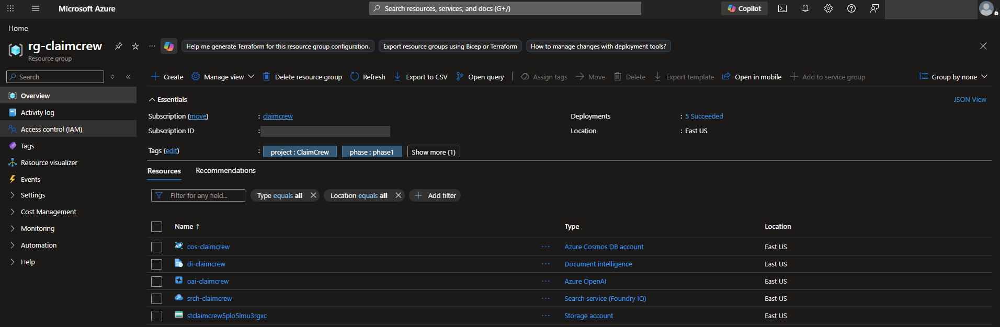

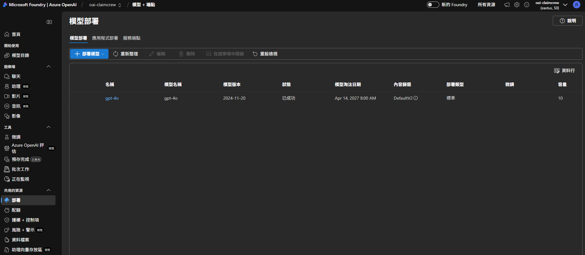

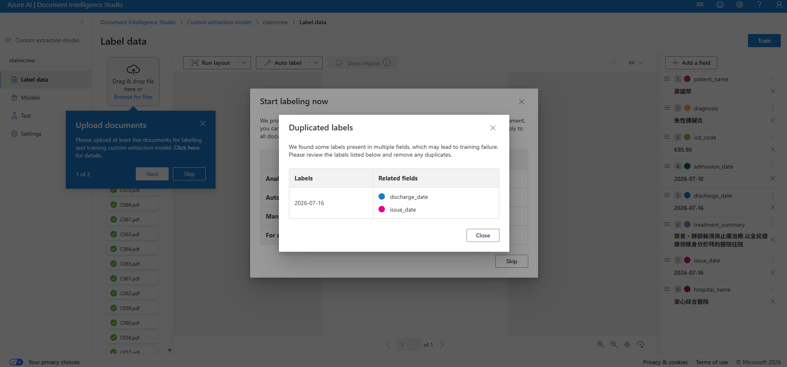

### 附:同日第二個真 API 校正——DI 標註「同值共框」
labels.json 格式被 Document Intelligence Studio 原樣接受(SPEC 掛號 ② 過關),但 Studio 立刻報 Duplicated labels:產生器對每個欄位值「取頁面第一個命中」,而出院日=開立日有 59 案、入院日=出院日有 6 案,兩個欄位因此指向同一個框。改為「依欄位順序取第一個尚未使用的框」,71 份標註重生成後 0 重複,並加回歸測試(舊產生器實測失敗)。教訓:**自動標註的正確性不能只驗「值找得到」,還要驗「框不重複」——同一頁出現兩次的值在真實文件裡是常態(當日出院當日開立),合成資料恰好放大了這件事。**


### 附:同日第三個真 API 校正——DI 模型忠實學到「只抽第一句」
`diagnosis-cert-v2` 訓練成功後以 C008 真實觸發:8 欄位 7 個一致、信心 0.80~0.97、版面文字含「第2次」三列(兩段住院有材料可拆)。唯一不一致是治療摘要只抽到逗號前第一句——回頭查標註,產生器對跨行文字整串搜不到就退回標點切段,15/71 份摘要只標了第一句,模型學的就是截斷。改為逐字座標、每一渲染行一框(71/71 拼接等於真值)後重訓 v3。這一段的教訓比前兩個更硬:**標註工具「有標到」不等於「標對」,只有把訓練好的模型打回原文件比對真值,才看得出標註的系統性缺陷。**

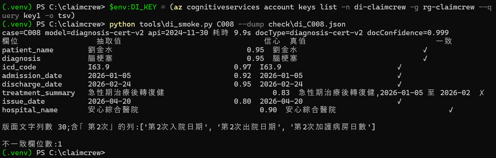

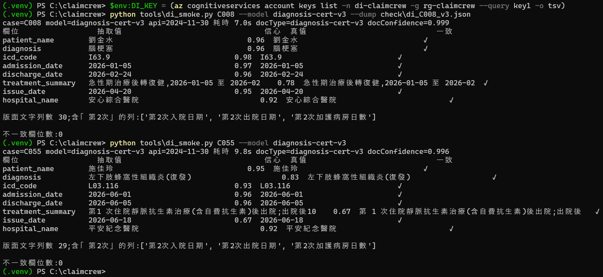
### 附:當日狀態
72 案 · 584 tests / mypy 0 / ruff 0 / selfcheck PASS · Azure 首次部署 11 資源 Succeeded · 預算 1,500 TWD/月 50/80/100% 警示(見 `screenshots/20260930_預算警示_1500TWD.png`)· gpt-5.6-luna 配額申請中(Application Id 59695)

## 2026-10-01 — ❌ 失敗紀錄:72 案首次全綠,eval 卻只有 0.139——門檻在「誤打誤撞」替模型擋錯

- **起因**:單 agent 骨架以證據優先流程完成(SPEC → 29 測試 → gauntlet),C008 三輪真打把 structured outputs 的 `$ref` 兄弟鍵、金額字串「142,500」、policy_id 填成保單號碼三個掛號逐一校正後,第一次對 72 案全量真跑。首跑先撞 429(gpt-4o 部署只開 10K TPM,單案 14k tokens 連一分鐘窗都塞不進),配額拉到 50K、重試改聽 Retry-After 後 72/72 全綠、$3.5。然後 eval:accuracy 0.139。
- **嘗試過程**:把 72 份 bundle 與輸出下載到雲端離線重跑 Gate(Gate 是純函式),拆出 Gate 前後兩張矩陣——模型原判其實 0.778,是 Gate 把 53 案改派人工。再往下挖出三個真問題:①模型完全沒做等待期/既往症前置檢查,8 案該拒卻核付;②37 案正確核付中 28 案金額錯(日數不含出院日、算式對結論錯、漏項);③33 案引用「不符」裡 46 筆只是全半形標點與 markdown 粗體。門檻格搜顯示:0.80 的「安全」來自它幾乎把所有案都轉人工,順便關住了那 8 案危險錯。
- **關鍵考量與抉擇**:三個問題分三刀:引文正規化(確定性,直接改);等待期用生效日與入院日程式算、ICD S/T 判傷害豁免(可算的交程式);金額改成「LLM 填算式材料、程式加總」(B1),否決「程式全算」(把條款裁量寫死)與「再加 prompt 規則」(C008 已證明算術規則擋不住)。v2 重跑:Gate 前 0.806、金額對 17/39——機制成立,但模型填進明細的材料仍錯(日期差算錯、單價限額填錯)。於是第三刀:日數/間隔/距生效日由程式算好注入(P1)、Gate 逐行反查條款金額參考表(P2)、日數候選集檢核(P3)。離線回歸:正確 17 案 0 誤旗標、22 案金額錯命中 17。
- **最終結果**:三份 SPEC、719 tests、18+6 個手動變異全殺;property 子集先抓到新 kind 不在不變量策略裡(M18 存活),補等式不變量與 `@example` 才確定性殺掉。遺留:漏列給付項目與 ICU 重複計日的程式檢核、`core+search` A/B、門檻格搜要等 v3 分數。

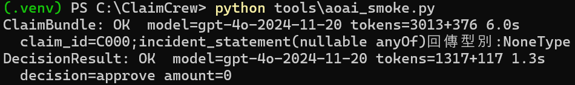

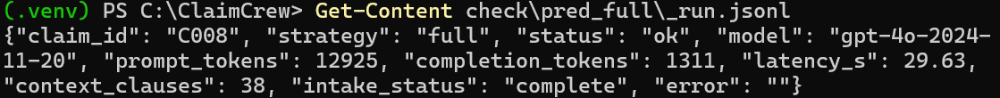

### 附:Gate 前後對照(首跑 → v2;列=真值,欄=approve/deny/manual)

| | 首跑 Gate 前 | 首跑 Gate 後(0.80) | v2 Gate 前 | v3 Gate 前 |
|---|---|---|---|---|
| approve(40) | 37 / 0 / 3 | 1 / 0 / 39 | 39 / 1 / 0 | 40 / 0 / 0 |
| deny(23) | **8** / 10 / 5 | 1 / 0 / 22 | **7** / 14 / 2 | **7** / 16 / 0 |
| manual(9) | 0 / 0 / 9 | 0 / 0 / 9 | 4 / 0 / 5 | 3 / 1 / 5 |
| accuracy | 0.778 | 0.139 | 0.806 | 0.847 |
| 金額對(兩側 approve) | 9/37 | — | 17/39 | 31/40 |

欄位信心門檻格搜(v2,引文正規化後;判定門檻 0.70 固定):t ≤ 0.70 為高原 acc 0.61 / 危險錯 2;0.72 起單調下滑;0.80 → 0.28 / 危險錯 1;0.85 → 0.15 / 0。門檻決定延到 P1–P3 的 v3 分數出來再做。

第三刀(SPEC-4)之後,只靠確定性旗標、不靠信心門檻:放行 18 案核付金額 18/18 全對、危險錯剩 1 案(第24條,語意題)。三輪下來的教訓一句話:**模型抄數可靠、算術不可靠、照流程寫不等於照流程做**——能算的全拿回程式,模型只剩「填材料」與「判定方向」。

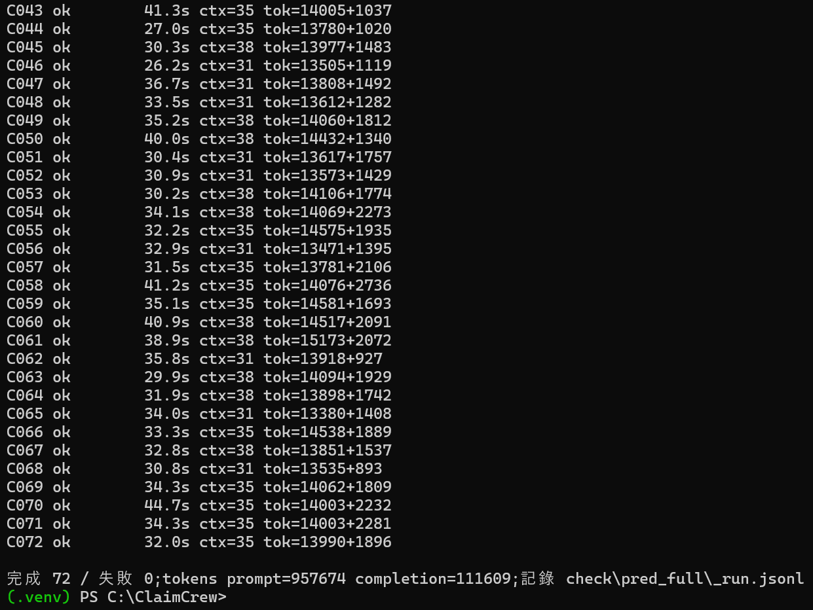

### 附:當日狀態
72 案 · 719 tests / mypy 0 / ruff 0 / selfcheck PASS · gpt-4o 50K TPM · 兩次全量 ≈ $7.5 · EVIDENCE `docs/evidence/EVIDENCE-20261001-single-agent.md`

## 2026-10-02 — 最後一輪磨:引文「跳列舉標記」安全版,換回 3~6 案不碰放行安全

起因:v6 是第一輪「放行皆對」的真實執行,但正確核付有 20 案被轉人工,最大單一原因是引文比對——模型把「一、保險金申請書。二、醫師診斷證明書。」抄成「保險金申請書、醫師診斷證明書」,內容逐字、只少了列舉標記;附錄表格則寫成「第二級手術:骨折開放復位內固定術」。SPEC-e 當時刻意不把「:」「、」當分隔符(會讓「第二級手術:新臺幣伍萬元」這種等級/金額重組矇混),所以這類誠實引文一直被擋。

做法:先把 v6 全部 16 筆不符逐筆對原文分三類,確認 12 筆是「形式不同、內容逐字」、4 筆是真改寫;再寫兩條窄規則——列舉標記視為片段邊界(片段仍須逐字、依序,漏項與錯序照擋),以及表格「第N級:項目」的每個項目都必須落在該級那一列(跨列直接不符)。離線用五組既有輸出重算:v6 0.569→0.611、core 0.611→0.694,五組放行金額全對、危險錯全零,4 筆真改寫一筆都沒放過。

走錯的一段:為了擋「扁桃腺切除術第二級」這種去標點後列尾黏到下一列等級的拼接,第一版在表格格界放了硬哨兵,結果把整表貼上、「第五級 冠狀動脈繞道手術」這些**誠實保留格界**的引文也打成不符——acc 數字還是升的,是看「哪些案降級變多」才抓到。改成「引文自身有標點處才可跨一格」後回歸才乾淨。

結果:865 tests、Gate 變異 39/39(新增 6 隻專打這兩條規則)。這是 Phase 1 的最後一刀——模型端 Gate 前 0.82 已是高原,Gate 側能安全換回的也換回了;剩下的降級是明細表示法與真改寫,前者要動 schema 契約、後者本來就該人工看。

### ❌ 失敗紀錄:放行金額連續三輪全對之後,第一筆錯是「兩個錯互相抵消」

起因:v7 是 Phase 1 數字最好的一輪(Gate 後 0.667、該轉人工的 9 件全進人工、危險錯 0),卻在 26 件放行裡出現一筆少付 3,900 的 C069——那是三輪「放行金額全對」之後第一筆錯,而且 Gate 一個旗標都沒舉。

拆解:把模型的算式逐行對真值推導式,少付 3,900 其實是 +1,300 和 −5,200 相加的結果。+1,300 是手術費與麻醉費拆成兩行、各自套了 20,000 的合計限額——這正是三天前 v4 C003 同一型錯誤,當時已經加了「同條拆行合計不得超過限額」的檢核;−5,200 是整條雜費行被漏掉,Gate 從沒有「收據有這類項目、明細卻沒對應行」的檢核。

為什麼舊檢核沒接住:C069 是非健保特約醫院、按 65% 給付,檢核比的是**乘完 65% 之後**的金額(14,300 < 20,000),比例把超限遮掉了;C003 沒有比例,所以同一支檢核在它身上看起來一直有效。換句話說,一個帶係數的檢核順序錯誤,在沒有係數的案例上永遠不會暴露。

抉擇:兩個洞一個是確定性檢核的真 bug(改成比係數前金額,六組輸出重算 0 誤旗標、C003/C069 都接住),另一個要新增提醒型檢核、而且會把「手術費(含麻醉)」這種合法寫法誤旗標。只修前者,後者寫進已知限制。

結果:一行邏輯、RED 先重現、一隻新變異守住;離線重算 v7 放行 25/25 全對。這件事改寫了一條工作規則:**金額錯一旦出現,先拆逐行差額再下結論**——總差額小不代表錯小,方向相反的錯會互相抵消;而「連續多輪 exact 1.0」只證明這幾輪的輸入沒踩到洞,不證明洞不存在。

### 附:當日狀態
**Phase 1 結案**:72 案 · 868 tests / mypy 0 / ruff 0 / selfcheck PASS · 變異 41+5+6 全殺 · 終版 Gate 對七輪真實輸出(504 案次)放行 161 件金額全對、危險錯 0;v8 終版 Gate 前 0.792 / 後 0.542 · 首月帳單 10/1 NT$399.80 全為 gpt-4o · EVIDENCE 第十~十二部分

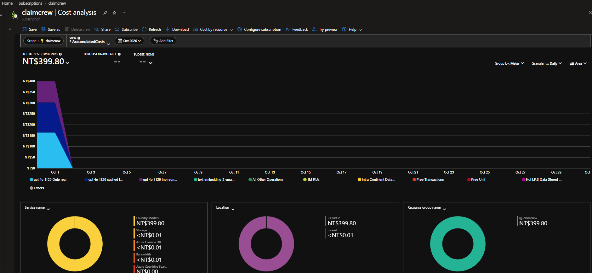

## 2026-10-02 — Phase 2 第一刀:ADR-007 定案——前提被推翻,結論反而更有價值

ADR-007 從 Phase 0 就寫著「抽取交給便宜模型省大錢」,一直是 proposed、沒有數字。Phase 2 開工的第一個決定是:先把它量出來,再談多 agent 拆分——因為拆分設計要回答「哪段用哪個模型」,這題的答案就是輸入。

路一開始就不平:ADR 原釘的 gpt-4o-mini 2024-07-18 已經 Deprecating,盤點整個 eastus2 的 mini 模型後只有 gpt-4.1-mini 能走 Standard SKU;Standard 配額 200K 現成,Bicep 開旗標、部署 59 秒。接著做逐呼叫 token 記帳,10 案一跑,第一個發現就把 ADR 的前提推翻:**抽取只佔 prompt 的 39%**,判定呼叫帶著條款全文、intake、bundle、derived_facts,才是 61% 的大頭。省幅上限被這個比例鎖死,不管 mini 多便宜。

價目表不憑印象:從 Azure Retail Prices API 抓 eastus2 的 regional meter,發現比公開定價頁貴 10%(2.75 vs 2.50)——如果照印象寫,所有成本數字都會低估一成。10 案配對先確認品質:4.1-mini 抽出的 bundle 與 4o **逐欄位相同**。然後跑 72 案全量路由臂。

結果:每案 0.0456 → 0.0302 USD(**−33.8%**),Gate 前 0.819、Gate 後 0.694(九輪最高)、該轉人工的 9 件全進人工、危險錯 0。比較時刻意把判定呼叫的快取順序效應正規化掉——路由臂緊接著基線跑,判定前綴還熱著,直接比會多算 5 個百分點,那不是路由的功勞。ADR-007 轉 accepted,抽取預設改為 gpt-4.1-mini。

唯一一筆放行金額錯(C051 多付 7,500)差點被歸咎給 mini,逐欄位比對後確認兩臂 bundle 一字不差,是 4o 判定呼叫這次把次高手術填成全額、而 Gate 因 15,000 同時是「第二級全額」與「第三級折半」放行了——一個五輪都沒暴露的表示法歧義洞,順手補成第 32 種旗標(多重集一對一配對)。

教訓:**成本工程的第一步不是換模型,是先量佔比**。剩下 70% 在判定呼叫的條款全文,而 ADR-005 已經證明檢索縮不了它——下一個槓桿不在模型選擇,在 prompt 結構。

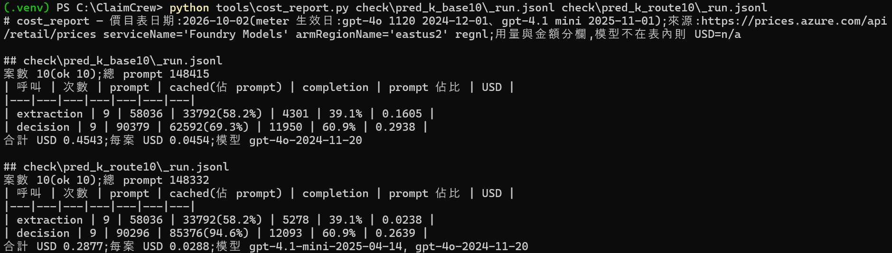

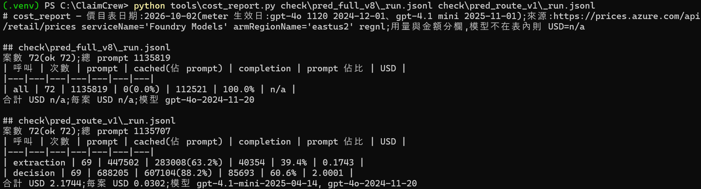

### 附:當日狀態
72 案 · 888 tests / mypy 0 / ruff 0 / selfcheck PASS · 變異 48+5+6 全殺 · ADR-007 accepted(抽取 gpt-4.1-mini,每案 −33.8%)· Gate 32 種旗標 · EVIDENCE 第十三~十六部分

## 2026-10-02 ~ 10-03 — Phase 2 第三刀:多 agent 該怎麼拆?量了三次,答案是「按驗證邊界拆,修補層不給放行權」

這個專案的命題是多 agent,所以 Phase 2 最重要的一刀是「還能拆出什麼 agent」。我沒有先畫角色圖,而是先問:拆哪裡有量得出來的缺口?三次量測,三個不同的答案。

**第一次:按知識領域拆,拆了變差。** 把 Policy(條款比對)從判定呼叫裡獨立成一個 agent,10 案探針 clause recall 0.772,門檻 0.80 沒過;漏掉的是 POL-A 第11條「住院醫療輔助保險金」×4——一條要先知道案情才知道該查的可給付條款。拆掉脈絡,agent 就變成純檢索。

**第二次:Foundry Agent Service 能不能當宿主?能。** 我原本以為 ADR-005 否決過它,翻回去看才發現否決的是 Search serverless preview,SPEC 寫錯了一行,先勘誤。SDK 從 wheel 內文查:azure-ai-projects 2.7.0 是 Agents v2,呼叫走 Responses API。桌機實跑連撞四個牆:並行建專案與部署 `RequestConflict`、角色名已更名 Foundry User、文件樣例的 `agent` 鍵回 400 要用 `agent_reference`、平行 function_call 只回第一個 → `No tool output found`。全部修完,10/10 schema 合法、快取 76~92%、臂間差異小於同臂噪音(把「identical ≥ 9/10」門檻設錯也如實記:mini 判定臂連自己跨次都只有 2/10 引文一致)。

**第三次:Repair agent——以 Gate 為工具的有界迴圈,帶放行權。** 旗標案統計說 Gate 後 0.556 → 0.819 的落差裡,「旗標已含正解」型占大宗(等待期未滿卻核付、漏第11條行、合計超限),所以設計了六道程式守門(Gate 重跑、禁升級、未點名行凍結、confidence 不得升、引文類案第二意見)再讓 agent 修。R1 兩組重放 +9 / +7 案、危險錯 0,但 route_v1 的 C003 放行少付 2,000:agent 把**收據事實** 22,000 改成 18,000 湊過限額。加第七道守門(事實不得縮水)跑 R2:C055 又放行多付 5,000——agent 把 kind 修對、Gate 卻沒有分段逐日限額的檢核;C065 更把應核付改成拒付去消解「理由寫拒付」的矛盾旗標。兩輪的共同結論很乾淨:**Repair 的每一件放行錯都對應一個 Gate 洞,它把「因旗標幸運人工」的案變成放行,等於把洞直接換成金額損失。** 依事前承諾不做第三輪。

### ❌ 失敗紀錄:兩輪 Repair 都沒過門檻,但失敗的形狀比成功有價值
- 起因:想讓多 agent 的「第四個角色」擁有真正的決策權。
- 嘗試:R1 六道守門 → 一件改事實;R2 加事實凍結 → 一件 Gate 洞 + 一件應核付改拒付;3 件 json_invalid 是我自己修平行呼叫時帶出的(兩個 JSON 相接),再修。
- 抉擇:門檻是寫死的(Gate 後 ≥ 0.75、放行金額 100%、危險錯 0),R2 v8 0.653、route_v1 C055 錯,就是不過;沒有移門檻。
- 結果:ADR-008——agent 按**驗證邊界**拆,LLM 修補層降為**顧問模式**(照跑、照守門、只寫建議、`applied` 恆 False),承載於 Agent Service,等 Logic Apps 人工覆核卡片給它讀者;Repair 的正向增益改用確定性手段拿:等待期/時效旗標直接改派 deny(八組歷史輸出 40/40 真值 deny、危險錯 0)、新增分段逐日限額檢核;拆行合併實作了但預設關——它在 v7 把 cap-sum 旗標消掉、露出漏雜費行的洞,又是同一個教訓。

教訓:**多 agent 的角色數不是指標,量得出來的缺口才是;而且 LLM 層每多一分權限,就要先問 Gate 對那類輸出的檢核完不完備。**

### 附:當日狀態
72 案 · 950 tests / mypy 0 / ruff 0 · 變異 72+5+6 · ADR-008 accepted · Foundry `fdy-claimcrew` eastus(4o + 4.1-mini)· 八組離線:P2+P3 每組 accuracy 皆升、自動拒付 40/40、放行錯不增 · 10/03 Azure 支出估 NT$85(Repair 兩輪 + 探針)· EVIDENCE 第十八~二十一部分

## 2026-10-03 — Phase 2 第四、五刀:補洞開合併,再給 AI 顧問一個讀者(Logic Apps 覆核卡片)

前一刀留下兩件事:拆行合併因為會露出漏行洞而預設關;Repair 降成顧問模式後沒有人在讀它的建議。這天把兩件都收掉。

**第四刀 SPEC-q:收據覆蓋檢核。** 洞的形狀很具體——v7 C069 收據有藥費、檢驗費,明細卻一行第10條都沒有,合併手術/麻醉拆行後 cap-sum 旗標消失,少付 5,200 就放行。對策不是改 LLM,是加一道確定性檢核:POL-C 核付時,收據命中的給付類別(第8~11條)必須有對應條號的明細行,否則轉人工。原型第一版在 v6 C033 / v7 C035 誤旗標兩件,原因是手術費行寫的是「附錄一」(手術等級表)而非第9條——把附錄一視為覆蓋第9條後八組誤旗標 0、只命中 C069。這道檢核補上後,合併開啟的八組重測放行錯 0,拆行合併才翻成預設開(四組各升 1~2 案)。pre-mortem 另提的「收據金額差額檢核」量完不做:36 個命中有 3 件金額正確,差額全是 per_unit 行不帶 actual_amount 造成,訊號不乾淨。

**第五刀 SPEC-r:Logic Apps 人工覆核卡片。** 這是 ADR-008 顧問輸出的讀者。設計上刻意把渲染放在程式端(可進 gauntlet、同輸入同位元組),Logic App 只「收 → 寄 → 回應」;兩個小決定是後來看最值錢的:工作流末端放 Response 讓 POST 同步回 200/502(非同步 202 會讓管線把寄信失敗記成 sent,半年後沒人發現),以及觸發 URL 的 SAS 簽章全程只走環境變數、所有訊息遮罩。通道選 Outlook.com 連接器——SPEC 早寫好「先砍 Teams 留 email」,且 OAuth 授權得在 Portal 按一次,Bicep 做不到,寫進 runbook。

### ❌ 失敗紀錄:卡片第一版把病患姓名寄出去了(合成資料,但紅線就是紅線)
- 起因:卡片的「案件事實」區刻意不取 patient_name / applicant_name,單元測試也斷言姓名不在 HTML 裡,全綠。
- 嘗試:門檻 R-M1 要求對 v8 全部 manual_review 案 dry-run 渲染並掃姓名——36 張有 3 張命中(C019/C020/C054)。追到源頭是 LLM 的 `citations[].relevance` 與 `reasoning` 自己寫出「依據<姓名>的住院事實」。
- 抉擇:不是改 prompt 叫模型別寫名字(LLM 用字裁量不可靠,固定解法 8),而是渲染層用 bundle 內已知姓名值對所有自由文字全文替換成 `<被保險人>`;先補 RED 再修,加變異 M81「遮罩關閉」確認測試不是空的。
- 結果:36 張 0 洩漏、最大 5,356 bytes;規則沉澱為固定解法 21——結構化欄位好擋,自由文字欄只有對真實輸出全量渲染才會露出洞。

教訓:**「測試全綠」和「對真實輸出全量跑一遍」是兩種不同的證據;涉及資料安全時,第二種不能省。**

### 附:當日狀態
72 案 · 969 tests / mypy 0 / ruff 0 · 變異 81+5+6 · Gate 旗標 35 種(新增 receipt_category_uncovered)· 拆行合併預設開 · Logic Apps 卡片程式側完成,真寄/授權/失敗路徑待桌機(runbook 4.17)· EVIDENCE 第二十二、二十三部分

### 附:截圖(2026-10-03~05,補登)
- 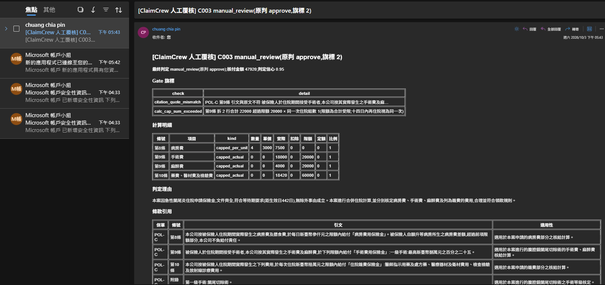
- 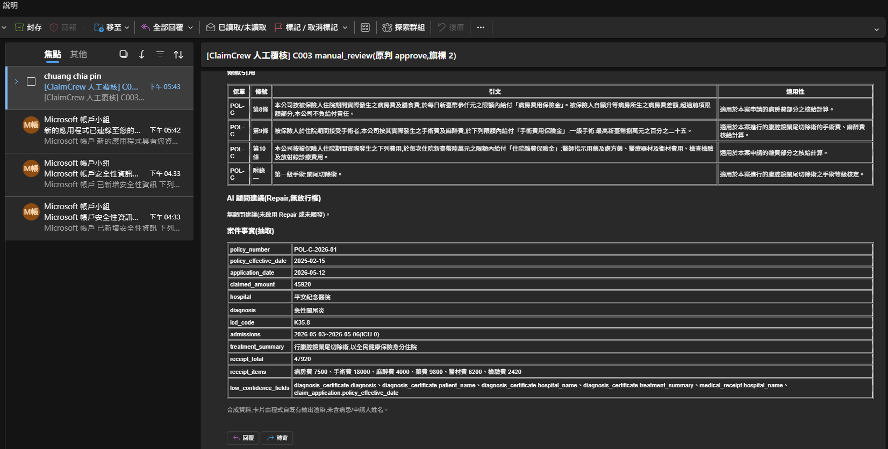
- 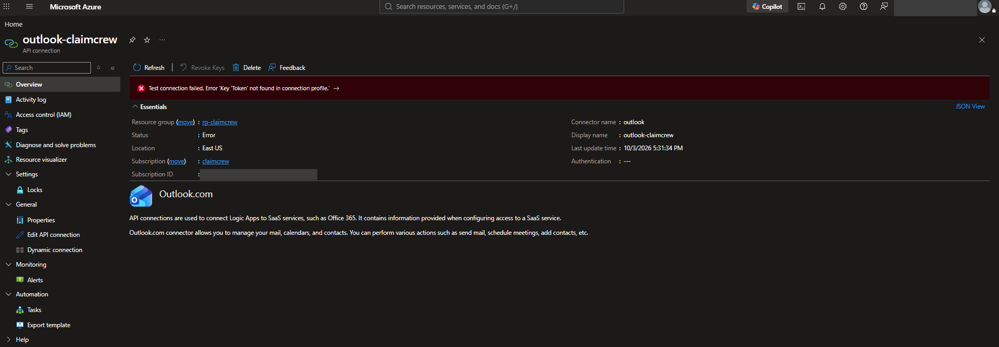
- 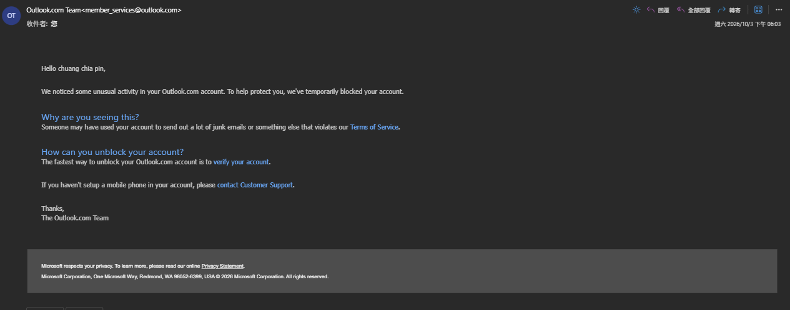
- 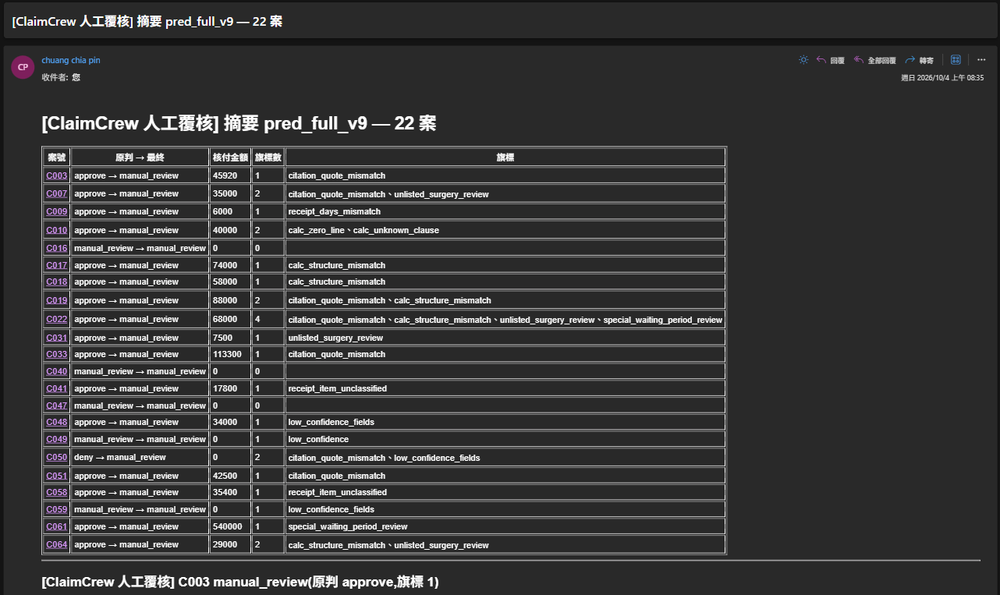
- 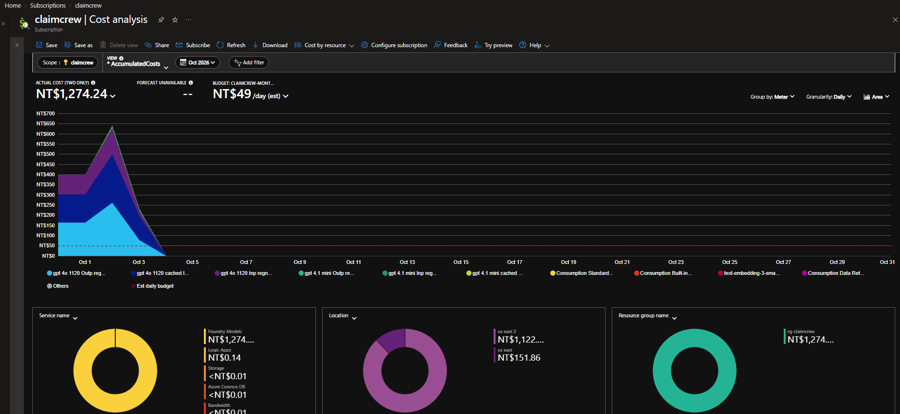

## 2026-10-04 — Phase 2 第六刀:管線上雲(Container Apps Job、無金鑰),首跑露洞、同日補洞

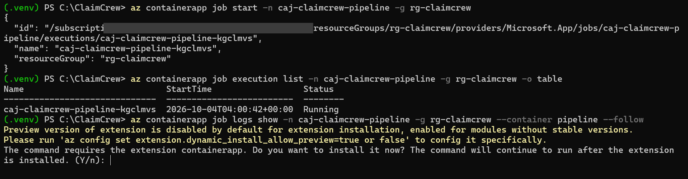

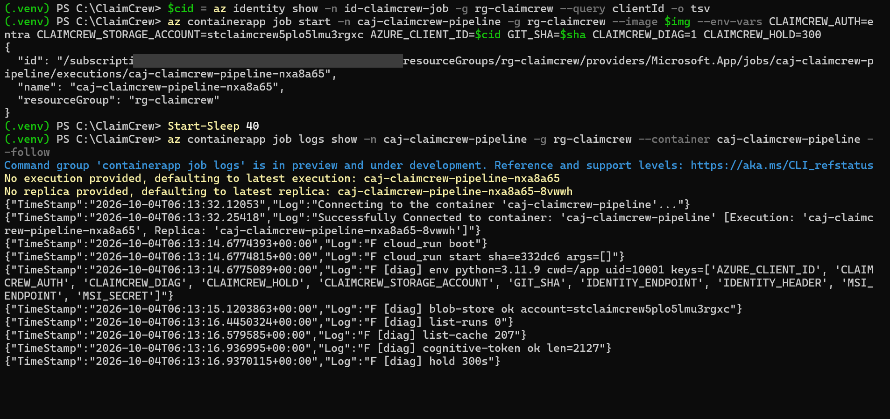

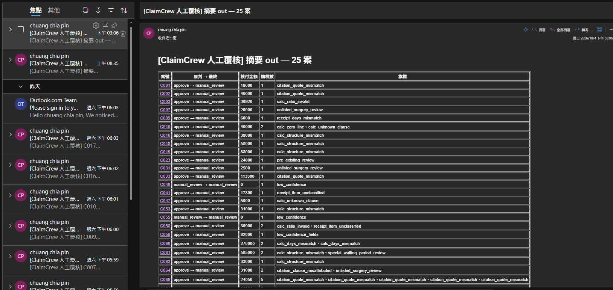

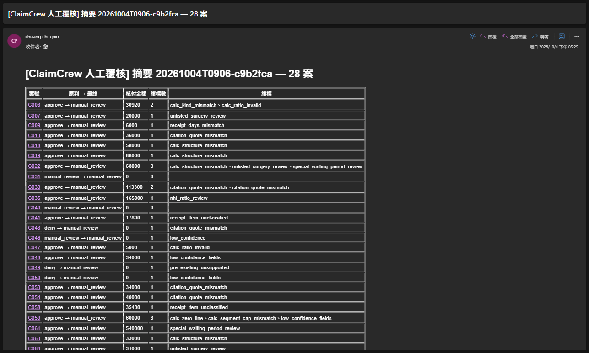

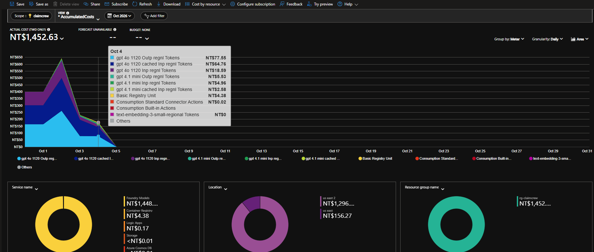

(文字素材見 build log 10/04 與 EVIDENCE 第二十五、二十六部分;事件摘要草稿已在對話中給出,待改寫)

## 2026-10-05 — Phase 2 第七刀:Content Safety「理所當然要接」?量完決定不接(ADR-009)

**起因**:全託管 Azure 方案裡,Content Safety 是看起來一定要接的服務。groundedness 原本設想成路由訊號:理由「無據」的放行案改派人工。要回答的問題是,它對理賠裁決管線有沒有實證價值。

**嘗試過程**:先以影子模式接入(F0、Entra 無金鑰、Bicep、影子欄位、eval 分群),不影響決策。接著每一輪都在拿到資料前把判準寫死並提交 git:放行全對案 ungrounded 中位數低於 0.15 才算可用,高於 0.35 就結案。

**關鍵考量與抉擇**:真正讓結論站得住的不是分數高低,而是兩個實驗。重複性實驗證明 API 對固定輸入完全決定性,所以三輪的差異是我方輸入設計造成,不是噪音。一組已知答案的對照(C066 捏造、C024 有據)直接顯示 API 判反,這比任何整體分布都更有說服力。注入測試則刻意補了拒付案,避免「注入目標剛好和原判一致」的漏洞。

**最終結果**:groundedness 與 Prompt Shields 都不進決策路徑,只保留成探針工具;Job 關閉 `--safety`。9 個注入變體(核准 3、拒付 6)在既有的「抽取 → schema → 確定性 Gate」邊界下放行 0、判定翻轉 0。教訓寫成固定解法 24:外部判定型 API 先量鑑別力,再量分布。剩餘限制:每變體單次、注入位置只測治療摘要、未測針對 Gate 的對抗文案。

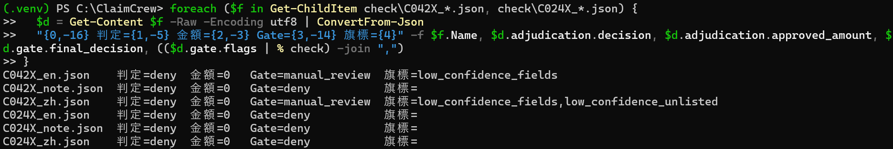

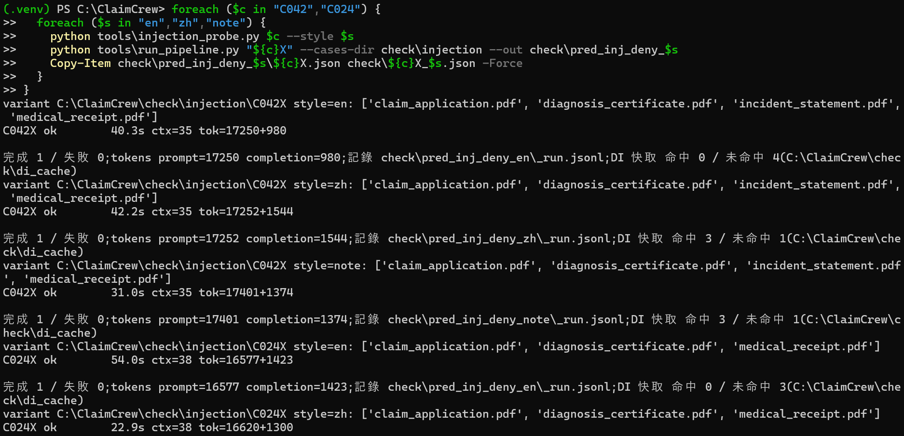

### ❌ 失敗紀錄:三輪輸入工程,在調一個不存在的訊號

- **第 1 輪**:中文整段被判成一個句子,分數幾乎是 0 或 1。根因是 API 只認 ASCII `.` 當句界,中文「。」和換行都不算。修切句後,放行全對案中位數 0.58。
- **第 2 輪**:把程式推導的事實(住院日數、距生效日)加進 sources,降到 0.46。看起來在進步。
- **第 3 輪**:條款加標籤、大寫金額旁註阿拉伯數字,只到 0.42,離門檻 0.15 還很遠。更糟的是,第 2 輪唯一抓到的真陽性(C066 既往症捏造句),加了條款原文後就消失了。API 分不出「條款定義了既往症」和「診斷書記載了既往症」。
- **錯在哪**:我兩次預估「下一步會有效」都被實測推翻。如果一開始就餵一組已知捏造與已知有據的對照,一次探針就能結案,不必花三輪。英文理由的分數(0.62~0.99)更高,也說明 API 對「裁決推論」這種文字的判讀和「摘要忠實度」是錯配的。

### 附:當日狀態
- 1039 tests / mypy 0 / ruff 0 / pip-audit 0 / 變異 107+5+6;ADR-009 accepted
- 證據:EVIDENCE 第二十七、二十八部分;約 760 次 F0 呼叫,成本 0

## 2026-10-05 — Phase 2 第八、九刀:合法值但非本案值(SPEC-w)、部分核付走中間方案(SPEC-x)

**起因**:原本只想查 C070/C035 的第 10 條引文。改用現行 Gate 重放 11 輪歷史輸出的全部金額錯核准案次(114 件)後,發現 3 件沒被金額檢核接住,其中 1 件會直接放行錯金額。共同型態是「填的值在合法集合內,但不是本案該用的值」:第三級手術定額套在二級手術上、兩段住院只填一段的日數。

**嘗試過程**:先用離線探針量三個候選檢核在 11 輪上的接住數和誤旗標數(接住 16、誤旗標 0),量過才寫 SPEC。實作時既有測試斷言「POL-A 不得出現某旗標」,我沒改舊斷言,改用新旗標名。接著處理部分核付:比較維持三分類、三分類加顧問欄位、四分類三案,選了中間方案。查台灣實務時發現保險法施行細則第 7 條要求「已認定部分先行給付」,推翻了真值裡「POL-A 無部分給付機制」的說法。

**關鍵考量與抉擇**:四分類要新增一條付錢路徑、讓 11 輪歷史基準歸零,受益卻只有 2/72 案。中間方案讓 LLM 填「可確定明細」,但沒有放行權,只顯示給人工,沿用 ADR-008 的顧問模式。

**最終結果**:SPEC-w 讓放行錯從 1 降到 0、誤旗標 0。SPEC-x 程式與 gauntlet 全綠(1074 tests、變異 120),實作中還抓到 regate 讀新輸出會崩潰的缺陷。但桌機驗證揭露一個 SPEC 沒料到的事實,見下方失敗紀錄。

### ❌ 失敗紀錄:桌機實測跑在舊程式上,也揭露中間方案的前提有洞

- **跑錯版本**:72 案全量和 C041/C064 各 3 次都跑完了,但輸出裡沒有任何新欄位。桌機執行時的程式早於 SPEC-x 推送:輸出檔時間(UTC 16:46)只比推送(16:40)晚 6 分鐘,且 C041 prompt tokens 16,511 與 cloud2 完全相同(新規則約 1,400 字元未生效),真因後來由第二輪的 pull 輸出確認:`git pull` 因桌機本地未追蹤的兩張 E3-c 截圖與我提交的同名檔衝突而 `Aborting`,桌機自 `6fff2c9` 起少了 13 個 commit,PowerShell 不會因前一行失敗而停止,後續指令照跑舊程式。我一開始憑「貼上的指令沒有 git pull」就斷定沒 pull,第二次又猜「推送前已 pull」,兩次都是無證據推斷。這輪結果仍是有效的 v10 基準(現行 Gate 重放:Gate 後 0.792、Gate 前 0.806、放行 28 件全對),但不能判定 SPEC-x。
- **更重要的發現**:回頭數歷史,模型在 C041 判了 15 次、C064 判了 14 次,**全部是核准,一次都沒自己判人工**。兩案都是 Gate 改派人工的。而中間方案的顧問欄位只在「模型自己判人工」時才填,所以對這兩個目標案,它很可能永遠是空的。
- **錯在哪**:SPEC 把「Gate 改派的人工案沒有顧問欄位」列為已知限制,實際上那是這兩案的主要路徑。我在寫 SPEC 前沒有先數模型的原判分布。如果先花一分鐘數,這個前提問題在設計階段就會被看到。
- **也排除了一條退路**:模型核准時的明細不能拿來當可確定金額。C041 的雜費 9,800 已經把爭議的處置費 4,000 算進去,C064 也把手術定額算進去了。

## 2026-10-06 — 版本戳記上線、v11 全量:判準沒過,但失分找得到主人

**起因**:前一天桌機實測連兩輪白跑,原因是 `git pull` 被本地未追蹤的截圖擋下而中止,PowerShell 卻照樣用舊程式跑完;我又兩次憑印象猜錯原因。需要一個不靠人記憶的方法,證明「這批輸出是哪個版本跑的」。

**嘗試過程**:在 `run_pipeline` 開頭印出「程式版本:<短 SHA>[+dirty]」,並寫進 `_run.jsonl` 每一列;沒有 git 的雲端映像記為 unknown,不中斷執行。runbook 補上 pull 失敗即停的寫法。接著跑 v11 全量,驗證 SPEC-w 的 Gate 首次線上執行,以及 SPEC-x 留下的 schema 欄位有沒有讓模型退步。

**關鍵考量與抉擇**:v11 的 Gate 後正確率 0.736,比 v10 少 4 案,超出事前寫死的 ±3。我沒有放寬判準,也沒有為了過關立刻重跑,而是逐案比對兩輪 14 件差異:失分全部來自模型這一輪算錯或判錯,其中 5 件核准金額錯、2 件把拒付判成核准,Gate 全都攔下,放行錯 0。判準依字面記為「未過」,歸因另外寫清楚。

**最終結果**:72 列版本戳記全是 `3cad367`,這是第一次不用靠檔案時間和 token 數反推版本。v11 放行 26 件金額全對、真值人工案放行 0、SPEC-w 新旗標誤旗標 0。遺留一個單輪無法分離的問題:schema 描述讓每案 prompt 多約 200 tokens,是否影響模型要再一輪才能確定。

### ❌ 失敗紀錄:同一件事猜錯兩次原因
- 第一次看到輸出缺欄位,我寫「桌機沒先 git pull」,依據只是貼上的指令裡沒有那一行。使用者說每次都有 pull。
- 第二次改用檔案時間和 prompt token 反推,結論是「pull 發生在推送之前」,仍然是猜測。
- 真因在第三次使用者貼的 pull 輸出裡:`untracked working tree files would be overwritten by merge` → `Aborting`。兩次都是證據不足就下結論,版本戳記就是為了讓下次不必猜。

## 2026-10-06 — 規則 9a 重試:先補 Gate 再改 prompt,判準撞上無關的舊漏洞

**起因**:SPEC-y 第一次改寫規則 9a 時,C073 過關,但 C072 的他保病房費被扣在雜費桶、放行多付 10,000,依事前判準撤回。當時的教訓是「改動已正確的 prompt 規則前,Gate 必須先有獨立檢核守住」(固定解法 27)。

**嘗試過程**:先做 SPEC-z,新增落桶檢核(14 輪重放接住 3 件、誤旗標 0),再重寫 9a:扣除只由收據影本觸發,桶與條款的對應逐一寫明,收據正本一律不扣。桌機 v13 中 C073 三次都沒扣,C070–C072 全對,但全量出現一件放行錯:C047 兩次門診手術各給 2,500,真值 2,500。

**關鍵考量與抉擇**:C047 是 POL-B、收據正本、他保全 0,9a 根本不會觸發。查 14 輪歷史,模型 11 輪都算錯,只是每次碰巧被不相干的旗標轉人工。照字面撤回 9a 會讓 C073 退回失分,也修不了真正的洞;直接無視判準則破壞事前登錄的意義。最後選擇另開 SPEC-aa 補 Gate(POL-B 第10條「十四日內同部位再手術視為同一次」),並把判準修訂的理由寫進 EVIDENCE、保留原文。

**最終結果**:新旗標 15 輪重放放行錯 0、誤旗標 0、接住 7 件金額錯,不用花錢跑桌機;9a 保留。遺留:模型只寫一行雙倍金額時新檢核不觸發,仰賴既有檢核。

### ❌ 失敗紀錄:給桌機的指令參數寫錯
- 我憑印象寫了 `--cases`,實際 CLI 是位置參數與 `--all`;四條指令全部空跑,eval 全部 missing。
- runbook 裡就有正確寫法,給指令前沒有對照。

## 2026-10-06 — prompt 修引文反而退步:量到就撤,順便挖出 Gate 缺口

**起因**:C035 的條款引文常把不同分項拼成一句(15 輪 5 次),雖然 Gate 都擋得住、只是多送人工,仍想用一條 prompt 規則減少人工件,並和確認 9a 的全量 v14 合併跑以省一輪費用。

**嘗試過程**:規則 2 增補「列舉條款整項照抄、跳項用『…』、禁拼接」,事前登錄硬判準(放行錯 0)、不退步判準(前 72 案 ±3)與效果判準。v14 結果:C035 4 次仍 3 次拼接,還多帶了「一、」前綴;全輪 Gate 前正確率 0.836 → 0.781,前 72 案少 6 件;另有 C029 放行錯。

**關鍵考量與抉擇**:合併跑的代價在這裡兌現——金額類退步分不出是新規則還是抖動。事前已寫好「無法歸因就先撤回」,所以沒有逐案辯護,直接撤回規則、保留 9a。C029 則不是 prompt 的錯:POL-B 單一手術填了合法但錯誤的等級金額(第三級 30,000 填 60,000),而 SPEC-w 的等級值檢核當初只做了 POL-A / POL-C。

**最終結果**:prompt 回到上一版;下一步補 POL-B 單一手術的 Gate 檢核,用 16 輪歷史離線量測。

### ❌ 失敗紀錄:為了省一輪費用把兩個實驗綁在一起
- 單輪全量同時驗證「9a 穩定」與「引文規則」,一旦退步就無法分開歸因,最後兩件事都得再跑。
- 引文規則對目標案沒有效果:模型照樣拼接,只是換了格式。修格式指示不一定改得了模型的引用習慣。

## 2026-10-06 — 同型漏洞第三次:Gate 檢核要按保單逐一盤點

**起因**:v14 的 C029(POL-B 單一手術)填了合法但錯誤的等級金額而被放行。SPEC-w 當初只為 POL-A、POL-C 做了「等級值是否為本案該用的值」檢核,POL-B 只在多手術時才檢。

**嘗試過程**:把同一個旗標延伸到 POL-B 單一手術:住院定額須等於該等級定額,門診須等於半額。先寫測試再實作,事前登錄重放判準。第一次變異測試有一個變異存活(「多手術名也套單一值」),原因是 AC4 測試挑的金額剛好等於最高等級,再補一條「第三級 + 第五級」的測試才殺掉。

**關鍵考量與抉擇**:這是同一型漏洞(合法值、非本案值)第三次出現:SPEC-w(POL-A/C)、SPEC-aa(POL-B 再手術)、SPEC-ac(POL-B 單一手術)。每次都是只補了發現的那張保單。改用 16 輪歷史離線重放驗證,不花一毛錢,上線前就知道誤旗標數。

**最終結果**:16 輪重放放行錯 0、誤旗標 0、接住 7 件金額錯,其中 2 件是 SPEC-aa 沒接住的寫法;gauntlet 1129 測試、Gate 變異 140/140。v15 全量將確認撤回後回到基準,並讓兩條新檢核首次線上執行。

### ❌ 失敗紀錄:補洞只補發現的那一格
- SPEC-w 設計時只看了出事的兩張保單,沒有把「三張保單 × 單一/多手術 × 住院/門診」列成表逐格確認。
- 結果同型漏洞在兩天內又出現兩次,每次都是模型偶發填錯才暴露。

## 2026-10-06 — v15 確認輪:撤回之後才看清,退步不全是改動造成的

**起因**:v14 合併了引文規則與 9a 確認,結果整體退步,依事前判準撤回引文規則。需要再跑一輪 v15,確認撤回後是否回到 v13 基準,同時讓兩條新 Gate 檢核(SPEC-aa 再手術、SPEC-ac POL-B 單一手術)第一次線上執行。

**嘗試過程**:跑之前先寫死判準:放行錯 0、C073 不扣除、前 72 案 Gate 後在 v13 ±3、Gate 前在 v13 ±0.04;並預先寫好「若沒回到基準,判定為既有漂移,不再改 prompt」。結果硬判準全過(放行 26 件全對、金額 exact 1.0),Gate 後 52 在範圍內,但 Gate 前 0.7945 比 v13 低 0.041,差 1 案沒過。

**關鍵考量與抉擇**:把 v11–v15 用同一口徑排在一起(前 72 案 Gate 前:47 / 51 / 45 / 47),v13 反而像是偏高的一輪。這說明 v14 的退步至少有一部分是模型每輪本來就有的波動,當時「無法歸因就撤回」是對的保守選擇,但不能把整個退步算在引文規則頭上。依預先寫好的後果,不再為此動 prompt。

**最終結果**:兩條新檢核首跑各接住一件真金額錯(C027 門診半額填錯、C047 同部位再手術雙給),誤旗標 0;9a 經兩輪(C073 5/5 不扣、C070–C072 全對)定案保留。遺留:單輪基準本身有 ±3~4 案波動,之後的判準需要改用多輪平均或區間。

### ❌ 失敗紀錄:用單一輪當基準
- v13 被當成「回到基準」的目標值,但它本身是偏高的一輪;以它為準,v15 差 1 案就判未過。
- 單輪全量的 run-to-run 波動(約 ±3~4 案)和要量的效果同一數量級,單輪對單輪的比較分不出訊號和雜訊。

## 2026-10-06 — 用矩陣盤點 Gate:主動找洞,而不是等模型偶發填錯

**起因**:「合法值、但不是本案該用的值」這型漏洞兩天內出現三次,每次都是模型偶然填錯才暴露。新規則(固定解法 28)要求按維度列矩陣逐格確認,這次第一次套用到現有的全部反查型檢核。

**嘗試過程**:把等級定額、日數、實付金額對收據、比例與扣除四類檢核,按「保單 × 單一/多項 × 住院/門診 × 單段/多段」展開,逐格標出已有檢核、缺口或刻意不檢,共找出 8 個缺口。接著不急著補,而是對每個缺口寫離線探針,掃 17 輪歷史輸出(約 1,240 案次),量出各缺口實際發生過幾次錯、有沒有被放行,並對照真值資料是否有這類案例。

**關鍵考量與抉擇**:量完發現 8 格中只有一格有實證(POL-C 雜費多填 34 件錯),而且全部被另一條為此設計的旗標(收據項目無法分類)接住,放行錯 0;其餘缺口歷史 0 錯,其中 3 格真值裡根本沒有對應案例,補了也只能靠單元測試驗證。若直接補雜費多填,目前寫法還會誤攔 2 案的正確答案。因此決定現在不補任何一格,只排出優先序。

**最終結果**:得到一張全量矩陣與缺口清單,不改程式、零成本。後續優先:①唯一只靠 prompt 守住的格子(收據影本 + 無法歸桶 → 人工)補上 Gate;②研究雜費多填檢核的誤攔原因;③POL-A 多段手術 / 加護需先有真值案例。

### ❌ 失敗紀錄:探針用關鍵字篩案差點誤判
- 用摘要含「術」判定有手術,把「三次住院均無手術」的 C061 也算成多段手術案,一度以為真值有這類案例。
- 逐案看原文才發現是「無手術」的否定句;關鍵字篩選的結果要抽查原文,不能直接當事實。

## 2026-10-06 — 把唯一靠 prompt 守住的格子補上 Gate,順便量出 Gate 的代價

**起因**:矩陣盤點後只剩一格完全靠 prompt 規則守住:收據影本且他保有無法歸桶的金額時要轉人工。專案原則是「LLM 判事實、程式管分流」,只靠 prompt 等於把放行權交給模型一次判斷。

**嘗試過程**:先列矩陣確認範圍,只補 POL-C 影本這一格;正本(C073 已決不扣)與定額保單刻意不檢。寫測試、實作、5 個手寫變異全殺,17 輪歷史重放誤旗標 0。同時做逐案波動分析:統計 73 案在 17 輪中的對錯次數,算出近期多輪基準區間(前 72 案 Gate 前 47–51、Gate 後 52–57),並統計 Gate 把模型正確答案改派人工的次數。

**關鍵考量與抉擇**:新檢核在歷史上觸發 0 件,代表無法用真實輸出證明它有效,只能靠單元測試與變異守住;選擇照實記下這個限制,而不是造一筆假的歷史資料來湊觸發。波動分析則把下一步的方向改了:Gate 把正確答案送人工共 105 次,其中 67 次來自引文不符旗標,比任何金額檢核的代價都大。

**最終結果**:Gate 旗標 42 種、1134 測試、變異 145/145;內部開發規則(未公開)進度摘要更新到今天。下一個最大槓桿是引文旗標的誤攔,而不是再補金額檢核。

### ❌ 失敗紀錄:先前把 Gate 只當成「越多越安全」
- 這兩天連補了五條金額檢核,每條都只量「接住幾件、誤旗標幾件」,從沒算過 Gate 全體的累積代價。
- 波動分析一跑才發現,引文檢核每輪平均把約 4 件正確答案送去人工,是「寧可人工」策略裡最貴的一塊。

## 2026-10-07 — 引文誤攔分析:最大的代價,放寬卻不划算

**起因**:逐案波動分析顯示 Gate 把模型的正確答案送人工 105 次,其中 67 次因引文不符旗標。想知道是 Gate 比對太嚴,還是模型真的改寫了條款原文。

**嘗試過程**:把這些案次裡 80 筆不符的引文逐筆分類:改寫 29、幾乎全非原文 20、與原文只差一兩字 16、片段都在原文但跳項沒加「…」12、順序錯 3。再對「跳項沒加…」這一類做離線放寬試算,17 輪重放 Gate 後正確 +7、新放行錯 0。

**關鍵考量與抉擇**:數字看起來安全,但放寬規則在原理上允許「不同分項的片段依序接起來」——拿第一級的「第一級手術」接第三級的「百分之一百」就能拼出條款沒有的句子;當初定下「冒號不作分隔符」正是為了擋這個,只是歷史資料恰好還沒出現。「差一兩字」那類也不能用相似度放行:一半是仟/千這種同義字,另一半是 C033、C035 那種只差一個字卻改了手術等級的拼接。每輪約 0.4 件的收益換一個結構性漏洞,決定不放寬。

**最終結果**:確認引文代價主要來自模型真的改寫,Gate 判對;prompt 要求照抄已實證無效(SPEC-ab)。根本解法應改為「模型只給條號與項次、程式從索引截取原文」,屬架構改動,待提方案。可順手做的只有把同義數字字(仟/千)納入比對正規化。

### ❌ 失敗紀錄:差點用歷史重放的「0 放行錯」當安全證明
- 放寬試算在 17 輪中 0 新放行錯,一度準備建議採用。
- 重放只證明「過去沒發生」,不能證明規則本身封得住;拼接型捏造在原理上可通過,這類漏洞要用構造反例檢查,不能只靠歷史資料。

## 2026-10-07 — 用 token 記帳對帳 Azure 帳單

**起因**:Cost analysis 顯示 10/06 單日約 NT$370、月預測 NT$7,395,想確認是否異常。

**嘗試過程**:用管線每次執行寫下的逐呼叫 token 記錄(含 cached)與釘選價目表,以 `tools/cost_report.py` 換算每輪全量約 USD 2.20 ≈ NT$70、單案重跑約 NT$1.6;10/06 當天跑了 v11–v15 五輪全量加三組單案重跑,合計約 NT$365,與帳單逐項吻合(4o 輸出 157、快取輸入 143、未快取輸入 36)。

**關鍵考量與抉擇**:月預測是把高峰日當常態外推,實際只在桌機執行時計費;真正要注意的是月累計 NT$1,926.77 已逼近 NT$2,000 警示門檻,下一輪全量就會觸發——這是成本取捨,交使用者決定是否調高預算。

**最終結果**:帳單可由 repo 內的記帳資料逐項重算,成本可解釋性成立;同日把「放寬 Gate 前先構造捏造反例」寫成固定解法 30。

## 2026-10-07 — Phase 2 收尾:用歷史輸出零成本產出完整基準

**起因**:Phase 2 只剩「完整基準」一項未勾。直覺做法是在桌機再跑幾輪全量,但每輪約 NT$70,且月累計已逼近預算警示。

**嘗試過程**:改用已存的近期 5 輪真實模型輸出,以現行 Gate(42 種旗標)離線重放,再跑 eval 與成本報告,彙整成單一區間表:Gate 後正確率 0.726–0.792、Gate 前 0.795–0.836、放行 133 件金額全對、危險錯 0、真值人工案 100% 送達人工、每案 USD 0.030、每案延遲 14–17 秒。排除 prompt 不同的實驗輪(v14)與舊 prompt 輪(v2–v9),口徑寫進報告。

**關鍵考量與抉擇**:基準用「多輪區間」而非單輪數字(固定解法 29),並把設計代價一併寫出——每 3 件改派人工只有約 1 件真需人工,這是「寧可人工、不放錯」的取捨,而不是藏起來的缺點。

**最終結果**:Phase 2 全部完成,花費 $0;月預算警示決定調升為 NT$3,000(待使用者於入口網站完成)。下一步進入 Phase 3 包裝。

### ❌ 失敗紀錄:彙整數字時算錯案次
- 初版報告寫「5 輪 655 案次」,實際是 72+72+73+73+73 = 363,提交後自查才發現並更正。
- 報告裡的每個合計數字都該由程式算出,不要手寫加總。

## 2026-10-07 — 階段 1 批量改善:一次離線重放驗四項,又抓到一個運氣型攔截

**起因**:分層準確率與決策地圖整理出兩個紅色風險(第24條無專屬檢核、無放行抽樣稽核)與幾處誤攔。依新定的「驗證成本原則」,純程式改動用歷史輸出離線重放即可,不必每項跑一輪全量。

**嘗試過程**:四項一起做:①第24條「等待期內已診斷」檢核(三張保單矩陣)②放行抽樣稽核(sha256 決定、10%)③診斷書開立日期不參與信心分流 ④引文仟/千同義。各自分開 commit,再以新舊 Gate 對 17 輪 1,227 案次各重放一次、逐旗標比較。①接住 C058/C049 全部 29 次模型誤判核付、誤旗標 0;④只少誤攔 1 次(預期 3–6)。

**關鍵考量與抉擇**:③看似最安全——開立日期在任何判定都沒用到——重放卻冒出 C059 放行錯 8 件:模型把「出院後第 15 天再住院」誤合併成同一次、少付雜費,原本完全靠開立日期信心低才被轉人工。事前判準寫了放行錯 0,直接撤回 ③,不爭辯。

**最終結果**:①②④保留,放行錯 0、Gate 後正確 870 → 871、無新增錯誤,零成本完成。新發現的缺口(合併限額造成的少付無檢核)列入補強計畫。

### ❌ 失敗紀錄:以為「欄位沒被用到」就能安全拿掉它的旗標
- 判斷依據只查了程式有沒有讀這個欄位,沒查這個旗標實際在擋哪些錯——它碰巧是 C059 唯一的防線。
- 第二個失誤:用來比對變異錨點的 scratchpad 腳本是舊副本,沒跟著 `tools/mutation_gate.sh` 更新,幸好 gauntlet 讀的是正本。

## 2026-10-07 — 階段 1 收尾:gauntlet 全綠、把撤回的教訓寫成規則

**起因**:階段 1 四項改動在 17 輪重放後撤回了一項(③),其餘三項需要完整 gauntlet 才能交付。

**嘗試過程**:gauntlet 跑變異測試期間,stop hook 兩度要求提交未提交的改動——那是 gauntlet 正在植入的變異體,不是真修改,因此拒絕提交;跑完確認還原無殘留後才推送。結果 1,150 測試、Gate 變異 155/155 全殺。

**關鍵考量與抉擇**:把 ③ 的失誤寫成固定解法 31——移除或豁免旗標前,先列出它作為「唯一轉人工理由」的全部歷史案次,有一案模型錯就不得移除。並把 ③ 意外挖出的缺口(出院後第 15 天再住院被誤合併限額而少付)直接排進下一項。

**最終結果**:Gate 旗標 43 種、放行錯 0;下一步補「合併限額少付」專屬檢核,讓 C059 不再靠運氣攔下。

## 2026-10-07 — 把運氣型攔截換成專屬檢核:合併限額少付

**起因**:階段 1 撤回 ③ 時發現,C059(出院後第 15 天再住院)常被模型誤當同一次住院,兩次雜費合用一個限額而少付 20,000;歷來全靠診斷書開立日期信心低才碰巧轉人工。

**嘗試過程**:新增 `calc_stay_cap_merged`:POL-C 第10條「每次住院」限額,若住院組數多於限額行數、且扣除前合計超過「行數 × 限額」即改派人工。依矩陣只做這一格(第8條已有分段檢核、第9條限額依手術等級)。第一版測試失敗是測試本身沒帶入住院資訊,合併函式把兩行併成一行;改成照真實流程傳入 bundle 後通過。

**關鍵考量與抉擇**:新檢核有一行與既有限額合計檢核一字不差,會讓舊變異 M40 同時改到兩處、錨點計數失準——把 M40 限定在原函式範圍、計數改為 2。17 輪重放:觸發 11 次全是 C059 的真錯、誤旗標 0、放行錯 0;Gate 後正確數不變,因為這些錯原本就被運氣攔下,改變的是「為什麼被攔」。

**最終結果**:C059 的主要錯法有了專屬防線;但仍有 1 輪(病房費填 0)只靠開立日期旗標擋住,所以 ③ 依固定解法 31 繼續維持撤回。

### ❌ 失敗紀錄:測試沒照真實資料流構造
- 單元測試用的輔助函式不帶 bundle,合併邏輯預設「只有一組住院」,把應該各自一行的明細併掉,造成假失敗。
- 測試要沿用正式流程的資料傳遞方式,否則測到的是另一條路徑。

## 2026-10-07 — SPEC-af 收尾

gauntlet 1,156 測試、Gate 變異 160/160 全綠後推送;SPEC 補強計畫中「合併限額少付」缺口結案。追查最後一個疑似只靠開立日期旗標擋住的 C059 v9 輪次,發現模型那一輪自己就判了人工(金額 0、無明細),不是放行風險——先前把「模型判錯」和「模型判核付」混為一談,高估了風險。

## 2026-10-07 — 附錄二改用 ICD 判斷,並重試先前撤回的開立日期豁免

**起因**:POL-A 第23條「特定疾病 90 日延長等待期」原本只能整窗提醒——距生效日 30~89 日的所有疾病住院一律轉人工,C061(呼吸衰竭、骨折)每輪被誤攔。另外,撤回 ③ 時唯一剩下的疑點(C059 v9)查證後發現是模型自判人工,並非放行風險。

**嘗試過程**:請使用者確認附錄二六類疾病的 ICD-10 範圍(惡性腫瘤 C00–C97、缺血性心臟病 I20–I25、腦血管 I60–I69、肝硬化 K70.3 / K74.3–K74.6、慢性腎臟病三期以上 N18.3–N18.6、糖尿病 E08–E13),提醒只在 ICD 命中時觸發,ICD 無法解析則保守照提醒;同時重試 ③。依固定解法 31,先確認收窄 / 豁免後沒有任何模型核付錯誤失去唯一防線(C049 改由第24條檢核接住)。

**關鍵考量與抉擇**:17 輪重放放行錯 0、Gate 後正確 871 → 880,90 日提醒觸發 42 → 14。但第一次 gauntlet 有一個舊變異 M23 存活:收窄規格後,原本殺它的測試參數(非附錄二疾病)不管有無下限都不會觸發,測試失去鑑別力。把參數換成附錄二疾病後恢復殺掉。

**最終結果**:C061、C059 的正確答案不再被誤攔;人工佇列減少,放行仍零錯誤。

### ❌ 失敗紀錄:改規格時沒檢查既有測試的鑑別力
- 收窄觸發條件後,只改了「預期結果會變」的兩組參數,沒想到另一組參數的鑑別力也被一併抹掉。
- 是變異測試抓到的;改規格時,受影響函式的每一組既有參數都要重新確認還在測它原本要測的東西。

## 2026-10-07 — 里程碑:改善流程階段 1–2 完成,全程 $0

**起因**:分層準確率與決策地圖整理出的紅色風險與誤攔,依「驗證成本原則」先做純程式、可離線驗證的部分。

**嘗試過程**:一天內完成 SPEC-ae(第24條等待期內已診斷、放行抽樣稽核、引文仟/千)、SPEC-af(合併限額少付)、SPEC-ag(附錄二 ICD、開立日期豁免重試);每項都用 17 輪 1,227 案次歷史輸出新舊 Gate 對照重放,事前登錄判準。

**關鍵考量與抉擇**:過程撤回一次(開立日期豁免導致 8 件放行錯)、補洞後再重試成功;兩度被變異測試抓到測試失去鑑別力。這些都在零成本的離線環境裡發生,沒有花一輪全量的錢去試錯。

**最終結果**:Gate 後正確 870 → 880、放行錯始終 0;Gate 旗標 44 種、1,189 測試、變異 166/166;新增固定解法 30–32。花費 $0。

## 2026-10-07 — SPEC-ah:事件觸發 + 失敗告警(改善流程 ⑥,$0、未部署)

**【事件摘要】**
- **起因**:「Azure 全託管」的聲稱有兩個落差——Job 只能手動觸發、失敗沒人知道;`eventgrid.bicep` 只有主題沒有訂閱,`monitoring.bicep` 從未部署。
- **嘗試過程**:三案比較(Event Grid → Queue → 事件 Job / 經 Logic App 呼叫 ARM / 只補監控),選第一案。動工前探針發現 CI 釘的 Bicep 0.30.23 沒有事件 Job 用身分讀佇列的型別,升到 0.36.1;共用 Log Analytics 時對條件式資源 `listKeys()` 讓編譯器直接崩潰,改成單一 `existing` 參照。
- **關鍵考量與抉擇**:佇列訊息「先刪後跑」(至多一次)——容器崩潰時寧可漏跑也不重複燒 LLM 費;案號白名單擋 `--from-queue` 被塞 `--all`;`bicep build` 0 warning 只證明型別合法,另寫 `tools/bicep_check.py` 對編譯後 ARM 斷言行為不變式(只收 requests/*.json、maxExecutions 1、無 Contributor 類角色)。
- **最終結果**:1242 tests、變異 172/172。手寫變異預檢抓到一個空過的測試:拒絕路徑的錯誤輸入同時讓檔案不存在,拿掉位置檢查也照樣被擋(→ 固定解法 33)。告警表名、KEDA 身分驗證、佇列角色三項只能在 ⑧ 重建時真實觸發驗證。

### ❌ 失敗紀錄
- 位置測試空過:錯誤輸入破壞了不只一個前置條件,拒絕發生在別處;只有變異測試能看出來。

## 2026-10-07 — ⑦ Cosmos 移除(ADR-010)與 ⑧ 重建清單

**【事件摘要】**
- **起因**:架構圖寫著「Cosmos DB 全案落盤」,但查 repo 發現程式零引用;實際落盤早在 SPEC-t 時就改成 Blob `runs/<run_id>/`。
- **嘗試過程**:先用 Portal Cost analysis(Cost by resource)量帳——10 月 `cos-claimcrew` <NT$0.01,總額 NT$1,928 中 99% 是兩個模型帳戶;再列三案:移除 / 改存覆核結果 / 維持現狀。
- **關鍵考量與抉擇**:改存覆核結果的前提(覆核回填介面)還不存在,接上也只是空表;維持現狀則保留說法落差。選移除,並寫 ADR-010 記下「什麼情況重開」(需要按案查詢或多人併發更新時,再比 Cosmos / Table / Blob)。另一個容易忽略的點:從 Bicep 拿掉模組**不會**刪掉已部署資源(incremental 模式),實體刪除交給 ⑧ 整組拆除。
- **最終結果**:Bicep 模組移除、SPEC / README / 中英專案頁同步改說法;⑧ 拆除重建整理成 runbook 4.23(拆前備份 DI 快取與雲端輸出、Cognitive Services 48 小時軟刪除需 purge、DI 模型同 ID 重訓、個人資料面角色重授、事件觸發與告警真實觸發),附事前驗收判準。量帳過程順帶發現一個早期探針留下的 eastus2 Foundry 帳戶仍在計費(本月 NT$7.19)。

## 2026-10-08 — 重建前盤點:DI 免費額度查證與待辦對帳

**【事件摘要】**
- **起因**:⑧ 拆除重建前要確認 DI 重訓會不會撞到 F0 額度;同時把散落的待辦對帳一次,避免重建後才發現漏項。
- **嘗試過程**:Portal Metrics 顯示本月 Processed Pages 1.17k,與印象中的「F0 每月 500 頁」矛盾;查官方配額頁後確認 500 頁出自定價頁,而配額頁另有兩條更關鍵的限制——**每次分析只回前 2 頁、單檔 4 MB、每區只能有 1 個 F0 資源**。接著離線統計 repo 內 220 份 PDF:全部 1 頁、最大 34 KB,0 份超限;重訓 Run layout 只需 71 頁(原估 140~210)。
- **關鍵考量與抉擇**:「每區 1 個 F0」讓拆除後的 purge 從「建議」變成「必要」(軟刪除中的資源可能佔住名額);「前 2 頁」若沒查,未來換成多頁真實文件時會靜默丟資料、模型看起來像壞掉。待辦對帳則把 runbook 5 個未勾項逐一對照 EVIDENCE 補勾,唯一真正沒做的是 `--repair` 顧問模式線上全量(非必要)。
- **最終結果**:⑧ 在 DI 面無阻塞(重訓只需 71 頁、0.5 訓練小時,遠低於 neural 免費 10 小時);500 頁月額度經定價頁原文確認,超額後行為官方文件(定價頁、配額頁)皆未說明,本月 1.17k 頁未被擋、未計費,原因不明;內部開發規則進度摘要更新至 10-08。

### ❌ 失敗紀錄
- 憑印象報出「F0 每月 500 頁上限」並據以估算,被實際 Metrics 推翻;真正影響架構的是配額頁上的「每次 2 頁」,而不是月額度——數字要查原文,不能只查一個。

### 補記(2026-10-08):查證來源的邊界
- 雲端 session 的 WebFetch 解析不到 `azure.microsoft.com` / `learn.microsoft.com`(容器網路政策,環境坑 C1),搜尋工具只回摘要;「查過了」實際上只拿到片段,原文由使用者在桌機貼回才完成查證。
- 教訓:回報查證結果時要分清「搜尋摘要」與「原文」,並明說哪個問題原文也沒有答案,而不是寫成「待查」讓人以為還沒查。

## 2026-10-08 — ⑧ 拆除重建:三次部署失敗與一次搬區

**【事件摘要】**
- **起因**:改善流程 ⑧ 要驗證「平時 $0、需要時從 repo 重建」。拆除(27 分鐘,比預估的 5~15 分鐘長)+ purge 4 個 AI 帳戶後,用含 SPEC-ah 監控與事件觸發的新 Bicep 重建。
- **嘗試過程**:①告警規則失敗——新 workspace 還沒有 `ContainerApp*_CL` 表,ARM 驗證查詢就拒絕;先加 `skipQueryValidation` 以為能過,重跑同錯(判斷錯誤),改成告警規則兩段部署(Job 首次產生日誌後再開);②Container Apps 環境失敗——`AKSCapacityHeavyUsage`,eastus 沒有容量建新叢集,等 70 分鐘重試仍同錯;③加 `containerAppsLocation` 把環境與 Job 移到 eastus2,一次成功。等待期間先做不依賴 Container Apps 的步驟:個人權限、Outlook 授權、Search 索引(72 案 recall 1.0)、DI 重訓。
- **關鍵考量與抉擇**:搬區只動 Container Apps 環境與 Job,ACR / 身分 / Storage / 日誌留原區——跨區流量極小,而整案搬區要重新驗證 DI F0、Search Free 在新區的可用性;選 eastus2 是因為模型帳戶本就在那裡。
- **最終結果**:基礎部署 Succeeded,`cae-claimcrew` 在 eastus2;Job 與事件觸發待第 7、8 步。三個坑記入 runbook W22–W24。「靜態驗證全綠」與「真部署成功」之間還隔著兩個只有真環境才會出現的問題(空 workspace 的表、區域容量),這正是 ⑧ 要做的原因。

### ❌ 失敗紀錄
- `skipQueryValidation` 憑印象判斷能解,未查證即推送,重跑同錯;代價一輪部署。應先承認「我的理解是…需要驗證」,再推。

### 補記(2026-10-08):⑧ 第 5–7 步通過
- DI custom neural 以同 ID `diagnosis-cert-v3` 重訓成功(Studio 舊專案沿用:專案設定存在 Studio 端、資源同名即對上;F0 批次 layout 429 屬預期,重跑 unanalyzed 至 71 份全綠);C008 / C055 皆 8/8。**同名不同模型**:C055 `issue_date` 信心 0.67 → 0.94、`treatment_summary` 0.66——管線 DI 快取(225 份)為舊模型產物、以 PDF 雜湊為鍵,v16 全量將全數命中快取,新模型只影響新 PDF。
- 順手修正 `tools/di_smoke.py` 預設模型仍為已刪除的 v2(回 404 ModelNotFound)。
- 映像 `claimcrew:62eb96d` 雲端建置 1 分鐘;帶 imageTag 部署 Succeeded——**事件 Job 建立成功即證實高風險假設 2**(ARM 接受 `Microsoft.App/jobs@2025-01-01` 的 KEDA scale rule `identity`);兩個 Job 映像皆指新 tag;DI 快取回推 225 檔。

### 補記(2026-10-08):⑧ T1 事件觸發端到端成功
- 上傳 `claims-inbox/requests/ok-202610081619.json`(`{"case_ids":["C003"]}`)→ Event Grid → 佇列 `claim-requests` → KEDA 啟動事件 Job(execution `caj-claimcrew-event-fr76s`,上傳後約 1 分鐘)→ Succeeded,執行 31 秒
- `run_meta`:`request` 正確、`pipeline_args` 只含 C003 且無 `--all`、帶 `--review`;`cache_pulled` 225 / `cache_pushed` 0(DI 全命中快取、0 次新 DI 呼叫);上傳 4 檔
- 跨區運作正常:Job 在 eastus2、Storage / 佇列 / 模型分別在 eastus 與 eastus2,以使用者指派身分無金鑰存取

### 補記(2026-10-08):⑧ T1 品質面與 T2 壞請求
- **T1 C003**:模型原判 approve 30,920(真值 45,920),第9條手術費誤填 `lump_sum` 20,000 × ratio 0.25(POL-C 第9條為限額型 `capped_actual`、比例只允許 0.65/1);Gate `calc_kind_mismatch` + `calc_ratio_invalid` 改派人工 → 放行錯 0。屬模型 run-to-run 波動,不是重建造成。**覆核摘要信實際寄達**(主旨帶 run_id `20261008T0820-62eb96d`)→ Logic App + Outlook 連線重建後端到端可用
- **T2 壞請求**(`{"case_ids":["--all"]}`):事件 Job execution 狀態 **Failed**(事前猜 Succeeded,錯——Container Apps 把非零結束碼記為 Failed);`run_meta` `status=failed`、`exit_code=2`、`error` 為 bad request、無 `pipeline_args`(管線未啟動、0 次 LLM 呼叫)
- 告警規則兩段部署成功(T1 產生日誌、`ContainerApp*_CL` 建表後 `enableJobAlert=true` 重部署 Succeeded)→ W22 根因判斷證實;告警信待收

### 補記(2026-10-08):⑧ 收尾——告警信到達
- T2 壞請求 08:43 UTC → Azure Monitor「ClaimCrew Job 執行失敗」08:49 UTC 觸發,信件寄達(截圖 `docs/screenshots/20261008_job_failed_alert.png`)
- ⑧ 驗收:重建、DI 重訓、Search、事件觸發、覆核信、告警全過;唯一未驗為「隔日 rg 費用 0」(同日重建無空窗)。SPEC-ah 兩條高風險假設皆在真環境證實
- 下一步 ⑨:以雲端 Job 跑 v16 全量,同時補缺口 G1(歷來 17 輪僅 2 輪在雲端)

### 補記(2026-10-08):⑨ v16 全量——首次由事件觸發在雲端跑完
- 上傳 `requests/v16-202610081659.json`(73 案號)→ 事件 Job 自動執行 25 分鐘(09:00:45–09:25:44 UTC)、145 檔上傳、DI 225 快取命中 0 新呼叫、摘要信 26 案寄達
- eval(Gate 後計分):Gate 前 0.726(53/73)/ Gate 後 0.6986(51/73)/ 危險錯(deny→approve)0 / 放行金額 exact 1.0 / citation precision 0.970 / manual recall 0.889(8/9):C031 模型原判 deny、無旗標 → 自動拒付(真值人工)。**更正**:先前寫「歷次恆為 1.0」錯——v6、v8 同案同型(deny 引第2條手術定義、無旗標);恆 1.0 只是 v10–v15。非新規則造成
- 小瑕疵:容器內 `run_pipeline` 印「程式版本:unknown」(無 .git),`run_meta.git_sha` 正確;待改為讀 `GIT_SHA` 環境變數

## 2026-10-08 — SPEC-ai:補拒付方向的手術認定缺口,順帶發現量測口徑的盲點

**【事件摘要】**
- **起因**:v16 雲端全量中 C031(大腸鏡瘜肉切除,真值轉人工)被自動拒付。模型以 POL-B 第2條「單純之診斷性處置不視為手術」拒付,而既有「未列表手術」提醒只在核付方向觸發。
- **嘗試過程**:先翻 18 輪歷史,找出所有「拒付 + 引第2條」案次:POL-B 5 次真值全是人工(另挖出 C007 胃鏡止血在 v3 也曾被自動拒付),POL-A/C 3 次真值全是拒付——差異來自只有 POL-B 的手術定義含診斷性處置排除。原想用「摘要含切除」當觸發,但會漏掉 C007,改以「拒付引用該定義條款」觸發。
- **關鍵考量與抉擇**:這是收緊規則(拒付 → 人工),代價是未來若有「純檢查、真值該拒付」的 POL-B 案會多一次人工——往安全方向的代價可接受。重放結果觸發 5、誤攔 0。
- **最終結果**:Gate 後正確 931→936。重放時發現先前報告的「放行錯 0」只計算了自動核付方向;把「錯誤的自動拒付」納入後,舊 Gate 實為 6 件,補完剩 v2 C061(第13條年度上限被當成整案拒付)。

### ❌ 失敗紀錄
- 量測口徑:「放行錯」長期只統計核付方向的金額錯,錯誤自動拒付(對保戶不利)沒有被計入,直到這次重放才暴露。
- 錨點檢查以 `| tail` 串接,失敗碼被吞掉,程式照樣 commit 並啟動 gauntlet;之後又用 `pkill -f pytest` 中止,連帶殺掉自己的指令(指令字串本身含 pytest)。
- 固定解法 34 加入內部開發規則(2026-10-08 核准):放行錯兩方向計數

### 補記(2026-10-08):SPEC-ai 上線,環境保留觀察
- 映像 `claimcrew:41705aa`(含 SPEC-ai)建置部署,兩個 Job 皆指新 tag;C031 線上抽驗模型判 approve → 舊旗標改派人工、結果正確,新檢核本次未觸發(只在模型判 deny 時觸發,歷史 3/18)
- 使用者決定**不拆除、保留環境觀察**:閒置常駐費用主要為 ACR Basic(約每天 NT$5),其餘只在執行時計費;後續可直接用事件觸發(上傳 `claims-inbox/requests/*.json`)跑案

## 2026-10-09 — 重建日的帳單:基礎設施近 $0

**【事件摘要】**
- **起因**:⑧ 拆除重建 + ⑨ v16 全量都在 10/8 完成,要確認「平時 $0、需要時從 repo 重建」的成本主張是否成立。
- **嘗試過程**:Portal Cost analysis 看 10/8 單日構成(截圖 `docs/screenshots/20261009_cost_oct8_rebuild.png`):合計約 NT$81——gpt-4o ≈ NT$70.7、gpt-4.1-mini ≈ NT$5.9(v16 全量 73 案 + T1 / C031 單案抽驗)、ACR NT$4.14、Azure Monitor 告警 NT$0.24、Logic Apps / Storage < NT$0.1。
- **關鍵考量與抉擇**:拆除、重建部署、DI custom neural 重訓、Search 索引重建在帳單上都看不到明顯費用(DI / Search 為免費層、模型部署按呼叫計費、Container Apps 只在執行時計費)——重建的成本幾乎全是「跑案」本身,不是「重建」。
- **最終結果**:10 月累計 NT$2,013.48 / 預算 3,000;閒置時每日約 NT$4–5(ACR + 告警),估月底約 NT$2,130(推估)。使用者決定先保留環境觀察。Forecast NT$7,019 為 Azure 依跑案高峰外推,非實際預期。

## 2026-10-09 — 收尾整理:讓文件與現況對齊

**【事件摘要】**
- **起因**:⑧ 拆除重建、⑨ v16、SPEC-ai 都已完成,但幾份文件還停在舊的狀態;另外 v16 的 `run_meta` 中 `code_version` 是 `unknown`(映像裡沒有 git)。
- **嘗試過程**:(a) `tools/run_pipeline.py` 的 `code_version()` 在沒有 git 時改讀環境變數 `GIT_SHA`,並補了測試(要等下次重建映像才會生效);(b) `docs/adr/README.md` 索引補上 ADR-009;(c) `ClaimCrew_PROJECT_SPEC.md` 把 G1/G2/G3(部分)/G5 標為已解決,⑧⑨ 打勾;README 的 Phase 1–3 進度與成本表同步更新;(d) 經使用者核准後,內部開發規則進度摘要更新到 10-09。
- **關鍵考量與抉擇**:每一項分開 commit(`cf2e2f3`、`958d4b3`、`4a2a1e5`、`bb8dc67`),方便日後追查;只修程式的 fallback,不為了它單獨重建映像。
- **最終結果**:文件與部署現況一致;已知殘留為 v2 C061;下一步候選是階段 5 ⑩(由程式填引文)。

## 2026-10-09~10 — SPEC-aj 程式填引文(⑩ 方案 A):離線完成、線上子集部署

**【事件摘要】**
- **起因**:18 輪 1,300 案次重放中,有 63 案次只因 `citation_quote_mismatch` 被轉人工,而模型原判的判定與金額全部正確,約占人工佇列 12%。放寬引文比對已經被固定解法 30 否決,只能改由程式產生引文本身。
- **嘗試過程**:先用 $0 驗證兩個假設。① 重放腳本的「模型正確」同時比對判定與金額,所以 63/63 在金額口徑下也正確,引文旗標不是任何錯誤的唯一防線。② 72 筆旗標全是改寫,沒有條號錯;其中附錄一表格被重排 25 筆、第9條與第10條摘要式轉述 23 筆。接著盤點 104 條條款,只有 5 種形狀(單段 / 本文+列舉 / 加末段 / 附錄表格 / 附錄編號清單),於是由模型指出 `segment`(本文、一…N、末段、表格等級列),程式從條款庫填入原文。
- **關鍵考量與抉擇**:沒有另建一個不含 quote 的型別,而是在 `PolicyCitation` 增加一個預設空值的欄位。原因是 `regate` 會把舊輸出轉回草稿重放,換型會讓 18 輪重放全部讀不進來。實作後 1,300 案次與上一版逐案完全相同。寫 RED 測試時發現一個洞:現行 Gate 會放過空引文,而新 prompt 要求 quote 填空字串,所以 Gate 一併補上「未指段落且無引文」的檢核。
- **最終結果**:Gate 旗標變為 46 種;gauntlet 1282 tests、變異 186+5+6 全殺(`d2991fa`、`df15101`);映像 `claimcrew:df15101` 已部署。待做:13 案線上子集驗收(誤攔大宗 10 案 + 3 個對照案),判準是放行錯 0、`citation_quote_mismatch` 0;segment 是否指對交由使用者抽驗。如果 `citation_segment_not_found` 超過 10%,改走方案 B。

### ❌ 失敗紀錄
- 第一輪 gauntlet 停在型別層:合併 dict 時多加了 `citations`,mypy 把值的型別推斷成 `object`,報了 6 個錯,變異層沒跑到。
- 新增變異 M181 要改的字串在檔內出現 2 次(`normalize_policy_id` 裡也有),若不限定範圍會一次改到兩處;寫入錨點前的全量比對抓到了這點(固定解法 23)。
- 部署時桌機 session 沒有設定 `$mail`,`reviewEmailTo` 被部署成空字串,摘要信與失敗告警的收件人同時被清空。部署照樣成功,只有在輸出的 parameters 才看得出來。

## 2026-10-10 — SPEC-aj 線上子集驗收不通過:消掉引文旗標後,露出 C069 的 Gate 洞

**【事件摘要】**
- **起因**:SPEC-aj(程式填引文)離線全綠後,以映像 `df15101` 跑 13 案線上子集(run `20261010T0356-df15101`)。
- **嘗試過程**:引文面的判準全部達成:81 筆引文中 `citation_quote_mismatch` 為 0、`citation_segment_not_found` 4 筆(4.9%),Gate 後正確 8 落在近 6 輪 [5, 8] 區間。但硬判準失守:C069 自動核付 25,350,真值 24,050,多付 +1,300。模型把手術費(18,000,掛「附錄一」)和麻醉費(4,000,掛「第9條」)拆成兩行,各套 20,000 上限;合併拆行與上限加總檢核只認第9條,所以漏接。這種形狀在 18 輪歷史中從未出現;以前 C069 常因引文旗標轉人工,是「幸運人工」。
- **關鍵考量與抉擇**:先前驗證的假設 1(63 案次只因引文旗標改派、且模型全對)只能證明歷史上引文旗標沒擋過錯,不能證明它日後擋不住新形狀的錯——這正是固定解法 20 / 31 的情境。另有兩個段落問題:C054 用阿拉伯數字寫等級(`第1級`),正規化沒有涵蓋;C033 把第二級手術指成第三級(金額用第二級算、結果正確),失效模型 ① 首次出現。使用者選擇先回退映像到 `41705aa`,離線補 Gate 後再跑子集。
- **最終結果**:SPEC-aj 暫不上線。待辦:① POL-C 附錄一手術行與第9條歸同一組合併上限 ② 等級標籤支援阿拉伯數字 ③ 18 輪重放 + gauntlet ④ 13 案子集重跑。C033 指錯段落列為已知限制(附錄等級正確性仍只靠金額類檢核守住)。

### ❌ 失敗紀錄
- 事前判準把「放行錯 0」列為硬門檻,子集一跑就擋下,沒有進入全量回歸。但離線階段的「重放逐案相同」只證明舊輸出不受影響,證明不了消掉旗標後的新輸出安全。

## 2026-10-10 — SPEC-aj 修訂:補上 C069 的 Gate 洞(附錄一限額行與第9條同組)

**【事件摘要】**
- **起因**:線上子集中 C069 被放行 +1,300 後,映像先回退到 `41705aa`,再離線補洞。
- **嘗試過程**:先依固定解法 28 盤點所有只認「第9條」的檢核:合併拆行、上限加總(F1)、手術等級限額(W2)三處都會漏接掛在附錄一的限額行;他保扣除落桶刻意不改(漏接時往人工方向,較安全);收據覆蓋已有對應檢核;POL-A/B 的附錄一是定額型,不受影響。新增共用函式 `cap_group_clause`,三處檢核共用;等級標籤一併支援阿拉伯數字(C054 的「第1級」)。
- **關鍵考量與抉擇**:端到端測試第一版沒附引文,被 `approve_without_citation` 從別的路徑擋下,等於沒測到金額檢核(固定解法 33);補上線上 C069 的原樣引文後,才在舊程式上真正失敗。阿拉伯數字正規化屬於放寬比對,依固定解法 30 先構造反例:「第4級」(POL-C 沒有此等級)、「10級」都仍會被旗標。
- **最終結果**:18 輪 1,300 案次重放變動 0;以新程式重跑線上 13 案,C069 = 24,050(等於真值)、C054 正確放行,放行錯 0,Gate 後正確數 8→10。新增變異 M189–M194,並更新 M68 的錨點。待辦:gauntlet 通過後提交、重建映像、13 案子集重跑。

### ❌ 失敗紀錄
- 修正前的錨點全量比對抓到 M68 錨點失效(合併鍵被改寫);若沒有先比對,gauntlet 會停在殘留偵測,多跑一輪(固定解法 23)。

## 2026-10-10 — SPEC-aj 第二次線上子集通過:程式填引文上線

**【事件摘要】**
- **起因**:補上 C069 的 Gate 洞(`cap_group_clause`)與阿拉伯數字等級後,以映像 `16157b3` 重跑同樣的 13 案(run `20261010T0514-16157b3`)。
- **嘗試過程**:兩次子集對照——放行錯 1 → 0;`citation_quote_mismatch` 0 → 0;`citation_segment_not_found` 4.9% → 1.6%(1/61);Gate 後正確 8 → 9(高於近 6 輪區間 [5, 8] 的上限);附錄段落抽驗由「C033 指錯 1 筆」變成 7/7 全對(C051 的「第3級 / 第2級」靠本次修正才對得上)。
- **關鍵考量與抉擇**:轉人工的 4 案都往安全方向:C069 模型金額正確但限額填錯(10,000 / 6,000),新的上限加總與等級限額檢核接住;C029 把等級標籤掛到第7條;C001 日額與輔助金不成對;C033 模型自判人工、信心 0.65。
- **最終結果**:SPEC-aj 上線(兩個 Job 都指向 `16157b3`);下次全量回歸時一併驗證 73 案。固定解法 35 加入內部開發規則(使用者核准):會消除旗標的改動必須跑線上新輸出子集,放行錯列為硬判準。

## 2026-10-10 — SPEC-ak 魯棒性(⑪):掃描化 / 雜訊 PDF 變體生成器

**【事件摘要】**
- **起因**:220 份合成 PDF 都是 reportlab 產生、帶文字層的乾淨檔,DI 幾乎不會讀錯,所以「讀錯時系統會不會安全轉人工」從未被測過。查 schema 時也確認:收據的 `items[].amount` 和 `total_amount` 沒有信心欄位,Gate 也沒有「項目加總等於總額」的檢核。DI 若高信心讀錯收據金額,目前沒有任何防線。
- **嘗試過程**:選了最無聊但最穩的方案 A——PDF 轉成影像,依等級做旋轉、模糊、降對比、椒鹽雜點、JPEG 壓縮,重新包成沒有文字層的影像 PDF,分輕度與重度兩級。子集改用收據金額最關鍵的 POL-C 核付 13 案,共 78 頁(全量 426 頁會逼近 DI F0 月額度,否決)。變體只放 `check/` 與 Blob,repo 只留確定性的生成腳本。
- **關鍵考量與抉擇**:①PIL 輸出 PDF 時會寫入當下時間戳,跨秒重跑位元組不同、DI 快取失效;原本的「同一秒呼叫兩次」測試抓不到,補了固定日期的斷言。②雜點測試第一版縮到 72dpi 再量,孤立黑點被平均掉,改用變體自身的 dpi 才有鑑別力。③全子集的大小測試每次約 20 秒,變異層若照跑會讓 gauntlet 多約 70 分鐘,所以只在完整測試層執行,並確認每條新變異都能被其他測試殺掉。
- **最終結果**:78 檔、432–524 KB(DI F0 上限 4 MB);重度劣化後收據金額仍可辨識。下一步在桌機跑三輪:乾淨對照、輕度、重度。硬判準是放行錯 0,另外量測人工比例與「靜默誤讀」件數。

### ❌ 失敗紀錄
- 確定性測試在同一秒內呼叫兩次,剛好避開了時間戳差異,讓「位元組穩定」看起來成立;改用跨秒實測才露出 `/CreationDate`。

### ❌ 失敗紀錄(2026-10-10 SPEC-ak gauntlet 逾時)
- 新增的 SPEC-ak 測試(PDF 轉影像)讓單次全套從 10 秒拉長到 18 秒;變異層約 200 個變異,每個都跑全套,gauntlet 在 50 分鐘背景上限時才跑到第 158 個,被強制終止,M156 變異體殘留在 `app/gate/checks.py`。我當初只把最慢的 ak4 排除,沒有量其餘測試加總的耗時。
- 處置:`git diff` 定位殘留單行後手動還原;劣化工具是獨立模組,一般變異改為不跑它的測試,它自己的 6 條變異改用專屬函式只跑該測試檔。內部開發規則雲端坑新增 D5(使用者核准):新增測試後先量全套耗時 × 變異數,估算總時長再啟動。

## 2026-10-10 — SPEC-ak 桌機三輪:劣化面判準通過,卻挖出兩個 Gate 洞

**【事件摘要】**
- **起因**:以 13 案 POL-C 核付件跑三輪(乾淨對照 / 輕度 / 重度劣化),量 DI 讀錯時系統會不會安全轉人工。
- **嘗試過程**:輕度、重度的放行錯都是 0;收據讀值和乾淨版不同的 4 件(輕度 1、重度 3)全被低信心或收據覆蓋旗標接住、轉人工,原本擔心的「DI 高信心讀錯收據金額」沒有出現。但重度有 9/13 案直接報錯:7 件是保單號碼被讀壞(`POL G 2026-01`),2 件是收據金額格式被讀壞(`8.000.`)。報錯的件只在 `_run.jsonl` 記一筆,不產出判定,也不進摘要信。
- **關鍵考量與抉擇**:意外的是**乾淨對照組**出現放行錯:C035 病房費行的 ratio 填 1,其他行填 0.65(非健保應一律 65 折),多付 +11,550。Gate 只逐行檢查 ratio 是否合法,沒有檢查同一案各行是否一致。歷史上 v10、v14 這種形狀都是靠 `citation_quote_mismatch` 幸運轉人工;SPEC-aj 消掉引文旗標後才露出來——又是固定解法 35 的情境,而兩次子集都沒放 C035。
- **最終結果**:使用者選擇兩個洞都補(先補 ratio 一致性,再讓報錯案改為輸出 manual_review 進摘要信)。補好之前線上 `16157b3` 不再跑案。

### ❌ 失敗紀錄
- SPEC-aj 的線上子集只挑了引文誤攔的大宗案,沒有把「歷史上靠引文旗標才轉人工、且模型金額錯」的案(C035 v10/v14)放進去;固定解法 35 要求的是「該旗標的歷史大宗案」,我挑的是誤攔大宗,不是遮蔽大宗。

## 2026-10-10 — SPEC-al:補上 SPEC-ak 挖出的兩個洞,⑪ 收尾

**【事件摘要】**
- **起因**:SPEC-ak 量測時,乾淨對照組的 C035 放行 +11,550(各行 ratio 不一致);重度劣化下有 9 件報錯,這些案件從摘要信裡消失。
- **嘗試過程**:①新增 `calc_ratio_inconsistent`:POL-C 第8~11條限額行(附錄一手術行歸第9條)的 ratio 必須一致。依固定解法 28 盤點:POL-B 次高手術 50% 屬合法混用,刻意不檢;POL-A 已由 `calc_ratio_invalid` 守住。18 輪觸發 11 次,全部是模型原本就錯的案件,誤攔 0。②報錯案改為輸出 manual_review,帶 `pipeline_error` 旗標並送卡;detail 截掉「原文片段」(可能含姓名,此時沒有 bundle 可以遮罩);`regate` 對這類輸出原樣保留,不再覆寫。
- **關鍵考量與抉擇**:改了兩條既有測試的斷言——它們原本斷言「報錯就不輸出」,正好是這次要改的行為,依核准的規格明確改寫,不屬於放寬測試。M203(附錄一沒有歸組)起初存活:測試中病房行本身就不一致,不論有沒有歸組都會旗標;改成「只有附錄一行不同」才有鑑別力。
- **最終結果**:線上驗證——C035 三次中,第 2 次重現原本的放行錯形狀(118,800),被新旗標接住;重度子集 13 案全部有輸出,8 件報錯案都轉人工。映像 `8b41aff` 已部署。Gate 旗標 47 種,1328 tests,變異 210+5+6。固定解法 36 加入(使用者核准):錨點預檢在前景單獨執行。

### ❌ 失敗紀錄
- 錨點預檢和 gauntlet 串在同一條背景指令,只看了結尾輸出;M206 錨點實際出現 7 次,`FAIL` 被埋在中間,gauntlet 停在 5b 層白跑一輪。同類錯誤 10/08 也發生過(`| tail` 吞掉失敗碼)。

## 2026-10-10~11 — SPEC-am 覆核閉環(⑫):不換 ACS,把「一輪一封」的摘要信變成可回寫

**【事件摘要】**
- **起因**:SPEC 原寫「覆核閉環需先換 ACS Email」,前提是「每案一封核准信」,而 Outlook.com 寄到第 6 封就封鎖。重新框定後,閉環真正需要的是「覆核結果能回寫,並能拿來對照模型判斷」,不一定要每案一封信。
- **嘗試過程**:方案 A——在既有摘要信的每張卡片附「填寫覆核」連結 → Logic App ① 表單頁(GET,只顯示)→ 按送出 → Logic App ② 以受控身分寫入 `runs/reviews-inbox/<guid>.json`;桌機用 `tools/review_stats.py` 統計推翻率、人工與真值不一致、可疑送出。ACS(方案 B)因網域驗證與費用未知被否決。
- **關鍵考量與抉擇**:安全設計三條,都由 `bicep_check` ⑦ 守住:①GET 不寫入,防止 Safe Links 預先開啟連結就自動送出;②Blob 檔名用 `guid()`,不拿使用者輸入組路徑;③表單回填一律 `uriComponent()`。欄位合法性改在離線統計時驗證,Logic App 本身保持最簡單。變異測試抓到兩個測試盲點:連結不做 URL 編碼時,HTML 跳脫仍擋得住 XSS,所以要另外測 `&`;路徑注入的測試要讓 `guid()` 與使用者輸入並存,才是真實的攻擊形態。
- **最終結果**:S1 程式端(`075d714`)、S2 Bicep(`d804ec3`)gauntlet 全過(225+5+6)。S3 實測:重新部署前後觸發 URL 雜湊相同(舊信連結不會失效);表單頁正常渲染並寫入 Blob(受控身分 HTTP 動作、`triggerFormDataValue` 兩項原本未驗證的部分都可行);摘要信 run `20261010T1601-d804ec3` 三張卡片都附上連結。Safe Links 預先開啟的觀察(30 分鐘)與端到端統計待完成。
- 截圖:`docs/screenshots/20261011_review_digest_with_links.png`、`20261011_review_card_link.png`、`20261011_review_form_recorded.png`

### ❌ 失敗紀錄
- 給桌機的計數指令用了 `--query "length(value)"`,又踩到 W24(az.cmd 吃掉括號),runbook 早有記錄卻沒避開;改用 `ConvertFrom-Json` 計數。
- 錨點預檢再次發揮作用:M211 的錨點含單引號,放進 bash 單引號字串就斷掉;依固定解法 36 在前景單獨跑,當場就抓到。

### 補記(2026-10-11):SPEC-am 端到端驗證完成,⑫ 結案
- Safe Links 觀察:摘要信寄出後 30 分鐘內,表單頁與送出端的觸發次數都沒有增加(1 / 1),沒有被預先開啟。這只是單次觀察,GET 不寫入的設計仍保留作為保險。
- 從摘要信點兩張卡片送出(C035 維持人工、C069 核准 24,050),下載後跑 `review_stats.py`:卡片 3、已覆核 2、涵蓋率 0.667、推翻原判 C035、與真值不一致 C035、可疑 0、無效 0,與事前寫下的預期完全一致;別的 run(s3test)的紀錄被正確排除。
- 閉環的價值第一次被量化:人工覆核本身也可能和真值不同(C035 真值為核准 107,250,人工選了維持人工)。

## 2026-10-11:v17 全量回歸,階段 5 結案
- 起因:⑩ 程式填引文、⑪ 雜訊 PDF 補洞、⑫ 覆核閉環三個改動上線後,需要一次全量確認沒有退步;判準在跑之前就寫進 EVIDENCE 47 並提交,避免看到結果再調門檻。
- 過程:桌機上傳一個請求檔,事件觸發 Job 約 54 秒後啟動、約 25 分鐘跑完 73 案;第一次下載因路徑少一層 `runs/` 抓到空清單,換路徑後取回 146 檔。
- 結果:七條判準 J1–J6 全過——自動判定 44 件全對(核付金額 24/24、拒付 20/20)、Gate 後 53/72、模型抄錯引文 0 件。
- 意外:原本預期引文誤攔消失後人工件數會下降,實際仍是 28 件(區間內);轉人工理由換成了算式結構類等確定性檢核。這說明程式填引文的價值是「去掉假旗標」,不是「減少人工」。

## 2026-10-11:補件流程刻意不做(範圍界定)
- 起因:v17 發現 3 件文件不全案(C006/C025/C026)不會出現在摘要信,因為它們提前結束、沒有抽取結果,不產覆核卡片。
- 選項:A 維持現狀;B 摘要信加一行「待補件」;C 表單加「補件」選項。
- 抉擇:追下去發現 C 不是加一個按鈕,而是一整套補件流程(狀態機、補件時效、通知保戶、重跑),若要處理真實掃描件還得先做頁面分類,而真實文件與「全合成、零 PHI」的定位直接衝突。這些是保險作業流程,不是 Azure 託管技術,對展示價值幾乎沒有加分。
- 結果:選 A,寫進 SPEC §12 範圍護欄第 7 條。明確說「不做什麼、為什麼」本身就是取捨的證據,比做一半的功能更有說服力。

## 2026-10-11:資料集設計註記
- 73 案含 3 件刻意設計的文件不全案(C006 缺收據、C025 缺診斷證明書、C026 缺理賠申請書且無法歸戶保單),驗證 Intake 確定性中止:以檔案存在性判定、不呼叫 LLM、零模型費用,真值皆為 manual_review。決定不以合成文件補齊——補齊等於刪掉這條路徑唯一的測試案例,並動到凍結真值。

## 2026-10-15~16:Demo 錄製與第二次全拆
- 起因:收尾要錄 3~5 分鐘 Demo 影片,並在錄完後拆除環境回到 $0。
- 過程:原計畫用 C010 示範「自動核付」,但實跑兩輪 C010 都被 Gate 攔下,而且兩輪錯法不同(一輪比例填錯、一輪漏套 65%)。回查歷史,C010 只有 10/19 輪自動核付正確——挑案時沒先查穩定度。
- 抉擇:不靠重跑碰運氣,改把 C010 當成「模型同一案每次錯法都不同,但每次都被程式攔下」的範例;自動核付的證據交給全量 v17(24 件全對)。這比「模型做對了」更能回答面試官最常問的「LLM 出錯怎麼辦」。
- 結果:A1~A20 錄完;覆核閉環 2/2、與真值 0 不一致;備份 841 + 303 檔異地保存後全拆,15 分 09 秒(上次 27 分),軟刪除全 purge。
### ❌ 失敗紀錄
- Game Bar 鎖定開始錄影時的視窗,切到瀏覽器仍錄到 PowerShell;檔案總管也錄不到——改成每段只在單一視窗內完成,A 編號只當剪輯切點。
- 新開 PowerShell 沒設 `$st`,upload 報 `--account-name: expected one argument`;覆核紀錄下載路徑多寫了 `runs/` 前綴、且同名檔讓下載中斷——都是文件指令沒實跑驗證過就寫入。

## 2026-10-19~20:公開發布

- 起因:收尾清單 ⑥,把私有開發 repo 變成可以放進作品集的公開 repo,同時不洩露個資與帳戶資訊。
- 嘗試過程:先掃全部 649 個追蹤檔與 52 張截圖,找到完整 gmail、訂閱 / Tenant ID、storage 帳戶名、舊 repo 網址;6 張截圖改用程式遮蔽版,runbook 改成占位符與 `$st` 變數;再刪掉與現況衝突的 README 路線圖、未使用的 `intake.md`、錄影規劃與 Phase 0 稽核清單,最後把文件裡對未公開檔案的指涉改寫。
- 關鍵抉擇:舊歷史裡仍有未遮蔽版本,所以公開版不搬歷史,以單一 commit 重新發布;私有 repo 保留完整紀錄。
- 結果:`seancpc/ClaimCrew` 628 檔上線,Pages 啟用;第一次 CI 因 gauntlet 15 分鐘逾時被取消(225 個變異全套約 40~50 分鐘),逾時改 90 分鐘後全綠(38 分 59 秒)。
### ❌ 失敗紀錄
- 第一輪掃描只看 md / html,漏了程式與 CI 設定檔註解裡的內部檔名;CI 紅燈後回頭擴大掃描才補齊。
